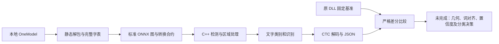

# OneOCR 原生源码版研究报告

> 本文保留第一阶段原始测量，包括当时的失败项。后续算法恢复和当前回归状态见 [第二阶段报告](2026-11-02_oneocr-parity-phase2.md)；以下 1/27、123 行等数值不代表当前实现。

分析日期：2026-11-02。当前交付为可构建、可运行的源码原型，**完整等价目标未完成**。本轮已证明原模型可以转换成独立数据，在 Windows 和 Linux 原生程序中运行；没有把仍有差异的输出标记成完成还原。

## 范围与证据

研究范围为本仓库的本地 OneOCR 样本与包装代码，按固定版本 reverse-skill 的离线样本流程执行。工具安装与源码获取单独访问公开上游；识别过程不访问在线 OCR 或授权服务。原始三个文件未修改，无 push、发布或模型上传。

案件与完整原始记录在 `work/oneocr-portable/`；[范围](../work/oneocr-portable/scope.md)、[时间线](../work/oneocr-portable/timeline.md)、[工作项](../work/oneocr-portable/workitems.md) 保留本地证据链。可提交的紧凑测量记录是 [verification.json](../research/verification.json)。

| Evidence | 观察与复现入口 |
| --- | --- |
| E-001 | PE 导入、导出、版本和 SHA-256；`scripts/research.py inventory` |
| E-002 | 无 DLL 静态解包，67 项资源；`scripts/unpack-onemodel.py` |
| E-003 | 原始资源绑定、完整字表与私有层转换；`scripts/prepare-models.py`、`scripts/convert-auxiliary.py --verify` |
| E-004 | 固定 ORT 提交的 Windows 源码构建、C++ 构建及测试日志 |
| E-005 | Linux 无网络命名空间执行，网络探针失败，进程映射无 Windows OCR DLL/Wine |
| E-006 | Windows/Linux 原生书页输出严格比较通过，均为 123 行 |
| E-007 | 与原 DLL 的书页严格比较失败：105 行对 123 行 |
| E-008 | 27 项固定用例均执行成功，全部指标同时对齐仅 1 项通过 |
| E-009 | 固定 Python 参考核心书页输出 58 行；不具备原始手写字段语义，严格比较失败 |

当前样本 `oneocr.dll` 文件版本为 `9.0.103`，容器 SHA-256 为：

```text
8ce0e666a3d78977152fe9676ae0636ea1c63c360442253aed3e90a9a0dc9cf1
```

原始 DLL 与配套 ORT 的 SHA-256：

```text
oneocr.dll:      0dbbec98e5e33de0be9b12d5f286011a6ea8f18e40baae092542b38ff00e7c7b
onnxruntime.dll: c23ac24e40ef4f94201d2b9265482ec211a28dfbf2c480273de35db97a38adbb
```

## 关键发现

### F-001：模型准备与推理可脱离原始 DLL

- severity: n/a_re
- evidence_ids: [E-001, E-002, E-003, E-005]
- confidence: high
- location: scripts/unpack-onemodel.py; scripts/prepare-models.py; native/src/engine.cpp
- status: validated

当前容器使用 AES-CFB128。首先在独立 Windows 进程的 BCrypt 解密边界观察明文，再与静态解包结果核对，避免照搬适用于另一种编码的 AES-CBC 假设。资源名只作为元数据，输出文件使用固定目录与摘要名，防止原包内 Windows 绝对路径影响写入位置。

67 项资源包含 34 个神经网络、原始字符索引、组合字符映射、校准表和配置。字表来自 `char2ind.txt`，保留 `<space>`、`<blank>`、`<trash_as_space>` 的元数据，不删除有效 ASCII 索引。原模型实际字体系为 CJK、拉丁、西里尔、阿拉伯、天城文、希腊、泰语、希伯来与泰米尔。

### F-002：私有特征层已转换为标准运算，但整条算法未等价

- severity: n/a_re
- evidence_ids: [E-003, E-007, E-008]
- confidence: high
- location: scripts/convert-auxiliary.py; research/portable-model-contracts.json
- status: validated

22 个私有 21→50 特征投影可还原为 Gemm/ReLU。参数来自反向序列化的浮点数组；使用原生中间张量确认布局，再以每个网络 64 组输入验证最终输出，最大差 `1.7673e-5`。该数值是记录的浮点归约差异，没有被写成零误差。

布局网络中的 256→16 投影对应 1×1 Conv，无后续 ReLU；12 次原生调用的输出比较误差为 0。检测器所需的 18 个 FPN 输出与原生张量重放比较误差为 0。转换合约同时锁定原图与转换后图的 SHA-256，日后准备同版模型无需再次运行 DLL。

原引擎在置信度、拒识网络之前还构造 21 项特征。这段特征计算、拒识接入、曲线文本区域处理及词框对齐尚未完整还原，不能因为网络已能运行就宣称算法已经等价。

### F-003：原生 Windows/Linux 运行链已验证

- severity: n/a_re
- evidence_ids: [E-004, E-005, E-006]
- confidence: high
- location: native/; CMakePresets.json
- status: validated

Windows x64 使用 MSVC 编译本项目，并从 ORT 提交 `a83fc4d58cb48eb68890dd689f94f28288cf2278` 构建 CPU DLL。Linux x64 使用 GCC 15.2 编译本项目，本轮链接的是摘要已验证的官方 ORT 1.23.2 CPU SDK；Linux ORT 自身源码构建未执行。

Linux 子进程在独立网络命名空间运行，联网探针返回 `Network is unreachable`，进程映射中没有 `oneocr.dll`、Windows ORT DLL 或 Wine。Windows 和 Linux 的书页结果均为 123 行，按同一严格比较器全部字段通过。

C ABI 的文件/带填充步长 BGRA 输出一致；同实例六个并发调用、两个独立实例并发、损坏字表摘要校验、丢失图片、最大行数与生命周期检查通过。Windows 旧接口适配库与新 API 在同一测试图上的严格结果比较通过。

### F-004：完整验收失败，不能宣布完成

- severity: n/a_re
- evidence_ids: [E-007, E-008, E-009]
- confidence: high
- location: scripts/compare-results.py; native/src/engine.cpp
- status: validated

| 指标 | 实测 |
| --- | --- |
| 固定合成用例执行 | 原 DLL wrapper 27/27；原生 CLI 27/27 |
| 全字段严格对齐 | 1/27，当前仅空白图通过 |
| 书页原 DLL / 原生 / Python 参考行数 | 105 / 123 / 58 |
| 原生合成用例平均进程耗时 | 约 0.50 秒，包含启动和模型校验 |
| 原生合成用例最大观测工作集 | 152,502,272 字节 |

严格阈值保持：文字、顺序、切词与手写类型一致；坐标最大误差 1 像素、角度误差 0.1 度、置信度差 `1e-3`。角度按圆周距离比较。1/27 是所有条件同时满足的比例，不是“只有一张图能识别”。

Python 参考核心在输入适配目录运行，适配目录显式记录它的字表大小标签与真实资源名的对应关系；未修改它的核心算法，也未调用它的下载器。其 `style` 表示横竖排，报告将手写类型写为未知，没有伪造为印刷体。它还会重新编号部分小字表索引，不能作为原 DLL 的等价实现直接移植。

## 调用与数据路径



### P-001

- title: 本地 OneModel 到可验证原生推理
- path_type: callflow
- start: 用户现有 oneocr.onemodel
- goal: 无原始 DLL、无在线授权服务的跨平台源码运行链
- steps:
  1. 固定样本与工具版本，记录 PE 锚点和摘要 — evidence: E-001 — finding: F-001
  2. 静态解包资源，绑定图、字表与校准数据 — evidence: E-002 — finding: F-001
  3. 转换私有特征层并核对原生探针 — evidence: E-003 — finding: F-002
  4. 编译 C++、构建 ORT、测试 C ABI 与兼容入口 — evidence: E-004 — finding: F-003
  5. Linux 断网运行并比较 Windows 输出 — evidence: E-005, E-006 — finding: F-003
  6. 与原 DLL 和参考实现比较，保留失败结果 — evidence: E-007, E-008, E-009 — finding: F-004
- residual_risks: 目前结果不等价，Android/macOS/ARM64 未验证，缺少真实手写测试图。

## 尚需完成的工作

1. 根据反编译出的 RelationRCNN、TextNormalizer 与 TextAnalyzer 流程，恢复真实的区域连接、曲线拉直、抑制与阅读顺序；当前最小旋转矩形与行排序是明确标记的实验实现。
2. 恢复原始字符帧对齐、词级区域映射和 21 项置信度/拒识特征，再接入已经转换的网络；当前词置信度仍是未校准 CTC 分数。
3. 恢复完整的方向与手写分类决策，补充真实手写样本。不能用手写字体代替真实手写验收。
4. 在 Android、macOS 和 ARM64 目标环境执行实际编译与运行；已提供配置不等于已经验证这些平台。

Ghidra 11.3.2 的工程、可重跑导出脚本及关键函数反编译结果保存在本地案件目录。已经解析嵌入的 Protobuf 描述与原始流水线配置，后续工作可沿现有证据继续，不必重新开始。

复现命令与接口说明见 [portable.md](portable.md)。第三方代码、独立准备工具以及微软模型的声明见 [THIRD_PARTY_NOTICES.md](../THIRD_PARTY_NOTICES.md)。
