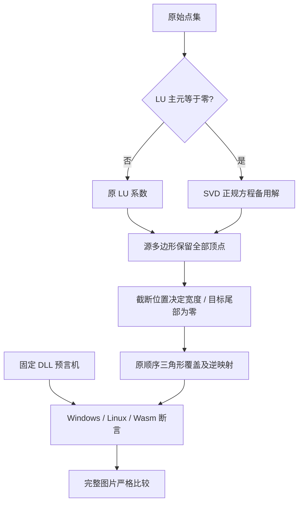

# OneOCR 曲线与极长行逆向报告

分析日期：2026-11-03。使用固定 reverse-skill 的普通逆向模板（flavor=null），不涉及恶意程序、攻击链或远程系统。

本轮恢复 LU 零主元时的 SVD 备用解，以及归一化宽度超限后的像素和词框逆映射。新增最大合法宽度的长行场景发现检测预处理另有 AREA 插值分支，已依据静态调用链和实际输入张量修复。原始模型、图片及严格比较阈值保持不变。完整执行结果和资源测量以[本轮回归报告](../reports/curve-boundaries-2026-11-03/README.md)为准。分支通过、有限场景一致不代表所有平台和参数组合完成。

## 范围与身份

授权与离线范围见 [scope](../research/curve-boundaries/scope.md)，过程见 [timeline](../research/curve-boundaries/timeline.md) 和 [journal](../research/curve-boundaries/field-journal.md)。用户已要求本地研究、测试、源码资产和报告提交；无 push 或上传。原始 DLL 未改写。

当前 DLL 是 Photos 2026.11090.22001.0 / OneOCR 11.0.15，SHA-256 `0a5e99041af902d6825f0af04ab25e62d2e2378ace69d10175f0dcc22816aae0`；模型 `f6cef38b839012cd824abf8b854ee9fa4f87d4c5265440661d66b23f4fab5155`。旧版 9.0.103 仅作内部算法交叉核验。PE 架构、版本、基址、导入和导出在 [assets.json](../research/curve-boundaries/assets.json)：核心 DLL 依赖本地 ONNX Runtime、Windows 系统 API 与密码/调试库；这些 Windows 依赖未引入可移植 C++ 引擎。当前基准和旧样本版本分别绑定，不能混用。

## Evidence → Finding → Path

完整 E/F/P 字段和内容 SHA-256 另存于[机器可读证据链](../research/curve-boundaries/evidence-chain.json)。

| Evidence | source_ref | repro_command | content_hash |
| --- | --- | --- | --- |
| E-001 | `research/curve-boundaries/assets.json` | 用 pefile 读取固定原始 PE 的 import/export/version；不加载目标 | [逐文件索引](../research/curve-boundaries/FILES.sha256.json) |
| E-002 | `research/curve-boundaries/static/{old,photos}/` | Ghidra 11.3.2 headless 分析固定 DLL，以 `scripts/ghidra/ExportFunctions.java` 导出本文 RVA | 同上 |
| E-003 | `contract.json`、`oracle-old.json`、七组 RGB、`oracle-crosscheck.json` | `python scripts/probe-curve-boundaries.py --photos --output work/curve-oracle/photos.json`；另去掉 `--photos` 输出到独立 old.json | 同上 |
| E-004 | `long-detector-input.f32` 和初次失败输出 | `python scripts/research.py extract --bin bin/photos-2026.11090.22001.0 --models work/curve-observation/models --trace samples/oneocr-boundaries/very-long-line.png --trace-label curve-observation`；需既有研究依赖 | 同上；失败输出见本轮报告 diagnostics |
| E-005 | `native/tests/boundary_test.cpp` 与最终 CTest/Wasm 构建日志 | `ctest --test-dir build/source-runtime -C Release --output-on-failure`；Linux 使用对应构建目录；Wasm 由 `scripts/build-wasm.py` 执行 | [本轮报告索引](../reports/curve-boundaries-2026-11-03/FILES.sha256.json) |

| Finding | severity | evidence_ids | confidence | location（旧版 / 当前版 RVA） | status |
| --- | --- | --- | --- | --- | --- |
| F-001：仅 LU 零主元触发 SVD 正规方程备用解 | n/a_re | E-002, E-003, E-005 | high | `e61f0→e4ea0/e48d0` / `58b070→58a380/58b580` | 源码和分支预言机已实现 |
| F-002：上限端点决定图宽，目标尾部仍为零，源三角形全部保留 | n/a_re | E-002, E-003, E-005 | high | `d9c40/dc510` / `524d80/52ab40` | 像素顺序与裁剪词框已实现 |
| F-003：逆映射使用裁剪前对齐的实际图宽与退化三角形选择规则 | n/a_re | E-002, E-003, E-005 | high | `ddd60/de340` / `52fad0/52f770` | 两方向、超出可见范围与弯曲源点已测试 |
| F-004：面积比例 ≤0.04 选择 AREA，否则 LINEAR | n/a_re | E-002, E-004, E-005 | high | 旧 `f9680` 常量映射、`1b2810` 选择；当前 DLL 实际张量 | 修复后检测输入逐元素一致，长行严格比较零失败 |

P-001，path_type=callflow：检测段点 → 保留原 LU 运算顺序 → 零主元才 SVD（F-001）→ 多边形目标宽度与零尾部（F-002）→ 所有三角形像素覆盖 → 裁剪词帧逆映射（F-003）→ 原坐标。P-002，path_type=solve：原长图 → 检测输入张量差异（E-004）→ 静态插值映射（F-004）→ AREA 输入逐元素验证 → 完整严格回归。



## 复现与限度

先按 [原生构建](portable.md) 或 [Wasm 构建](wasm.md) 准备固定依赖。原生 CTest 自动读取已提交预言机；Wasm 构建同时核验测试成功标记，避免 data 文件未加载却零退出的假通过。几何预言机直接调用内部函数，最大宽度 297；它不是公开接口参数，没有放宽合法缩放范围。四张 PNG 单独用于全图推理，不能用图片外观代替内部路径覆盖证据。

如需重新导出静态函数，在项目根目录、已按案件 tool-index 准备 Ghidra 11.3.2 与 JDK 21 后运行：

```powershell
$env:JAVA_HOME = (Resolve-Path 'work/vendor/jdk21/jdk-21.0.8+9').Path
New-Item -ItemType Directory -Force 'work/curve-repro' | Out-Null
& 'work/vendor/ghidra/ghidra_11.3.2_PUBLIC/support/analyzeHeadless.bat' 'work/curve-repro' 'PhotosRepro' -import 'bin/photos-2026.11090.22001.0/oneocr.dll' -analysisTimeoutPerFile 120 -scriptPath 'scripts/ghidra' -postScript ExportFunctions.java 'work/curve-repro/decompiled' 18058a380 18058b580 18058b070 180524d80 18052ab40 18052fad0 18052f770
```

动态预言机命令需要 Windows x64、NumPy 和配套 DLL，必须在独立子进程中执行。它对未知 DLL 摘要直接拒绝调用，不根据猜测自动换地址。使用普通 Python 时先按项目研究依赖准备环境；正式运行的原生或 Wasm 引擎不需要这些研究依赖。

固定集验收仍为文字、阅读顺序、词切分与手写类型完全一致，坐标最大 1 px、角度 0.1°、置信度 0.001；不改变比较器。内部系数、RGB 与检测输入要求逐元素一致，56 组词框内部断言为 0.0001 px。

macOS x64/arm64、Android arm64-v8a、Linux ARM64 未进行目标构建或运行验证；Safari、Firefox、移动浏览器和 Node 20 全量集未验证。非默认参数组合、独立真实手写及更多文字类别仍需扩展证据。`engine.parity=incomplete` 保留，全部跨平台目标继续标记未完成。模型权利声明与所有依赖版本锁定保持原样。
