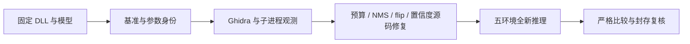

# OneOCR 非默认参数与真实中文手写还原报告

本轮固定 Photos 2026.11090.22001.0 的 OneOCR 11.0.15 与原模型，补充真实纸面中文手写及非默认参数覆盖，并还原四处源码处理差异。[执行报告](../reports/options-handwriting-2026-11-03/README.md)记录实际结果；整体兼容性仍为 incomplete，有限样本不能证明所有图像与参数等价。

## 范围与方法

使用 reverse-skill `cab634bd855fc287f6e420c1f36fd1a6b9245960` 的 R22 / Ghidra 离线样本路由。[scope](../research/options-handwriting/scope.md)、[路由](../research/options-handwriting/route-scope.md)、[时间线](../research/options-handwriting/timeline.md)、[工作项](../research/options-handwriting/workitems.md)和[E/F/P 索引](../research/options-handwriting/report/findings.md)随项目保存。公开样本获取与离线观测分别记录，没有联网 OCR、模型替换、上传或磁盘 DLL 补丁。

| 资产 | 固定身份 |
|---|---|
| oneocr.dll | SHA-256 `0a5e99041af902d6825f0af04ab25e62d2e2378ace69d10175f0dcc22816aae0` |
| oneocr.onemodel | SHA-256 `f6cef38b839012cd824abf8b854ee9fa4f87d4c5265440661d66b23f4fab5155` |
| oneocr_wrapper.dll | SHA-256 `1e9027763cf23f144dd84f3a1a83ab067bbb9d0401934c36741315ff9a42a2a7` |
| prepared manifest | SHA-256 `8e6d5b973aad14590890ce78de39e5414b7297df4350d65e7a2990ab9b9c929a` |
| 严格比较器 | SHA-256 `06d137cc93680f766031d783da9526064808fea1135124348e180bb8607f4869` |
| 原生运行后端 | ORT v1.23.2，提交 `a83fc4d58cb48eb68890dd689f94f28288cf2278`，源码构建 |
| 工具 | Ghidra 11.3.2、JDK 21.0.8+9、独立 Python 子进程；Windows / WSL x64 |

Photos ORT 1.24 仅作原始对照；正式后端仍为 ORT 1.23.2。配套库摘要和原始资源在冻结资产与每份 oracle 中保留，不按体积猜测模型角色。

## 新覆盖

新增 12 张图片：两张独立来源的真实纸面中文手写照片、各自 90/180/270/10 度变换共八张，以及打印十二行与空白控制图。来源为摄影者 jason hu 的两张 Unsplash 照片；交付为 CDN 版本，非相机原片。来源、许可、下载地址、文件摘要及变换参数见[provenance](../samples/options-handwriting/provenance.json)。摄影者未标明书写者，不能据此宣称多书写者覆盖，也不强改原 DLL 返回的 printed/handwritten 类型。

[参数清单](../research/parameter-cases.json)包括 67 组：66 个非默认组合与一个完整默认对照。55 项为打印图 11 种行预算 × 5 种共同有效尺寸，六项为两张手写各三组，两项零别名，四项空白边界。范围为 126 张样本 + 27 项语料 + 一页书 + 67 参数组合 = 221 项/环境。参数身份、输入摘要及原始基准摘要均纳入执行与复核，同图不同参数不能互相替代。

## Evidence → Finding → Path

| Evidence | source_ref / 复现入口 | content_hash / 原始产物 | Finding |
|---|---|---|---|
| E-001 | `scripts/capture-options-oracles.py` | [记录](../research/options-handwriting/evidence/E-001.md)，索引 SHA 在记录内 | F-001 整分量预算批次 |
| E-002 | 同上，区域/NMS 观测 | [记录](../research/options-handwriting/evidence/E-002.md)，完整 JSON 与反编译 | F-002 粗包围框门控 |
| E-003 | 同上，trace 输入张量 | [记录](../research/options-handwriting/evidence/E-003.md)，实际 layout 输入 | F-003 flip 后版式 |
| E-004 | 同上，实际 LineResult+0x5c | [记录](../research/options-handwriting/evidence/E-004.md)，分数与选择索引 | F-004 输出置信度加权 |

复现：在仓库根目录执行 `.research-python/python.exe -X utf8 scripts/capture-options-oracles.py --output work/reproduce-options-oracles`。每条 E 的 source_ref、repro_command、artifact_path、SHA-256、status、location 可机器校验。F-001..004 均为 `severity: n/a_re`、`confidence: high`、`status: validated`；P-001 为 solve 路径，详见[规范化记录](../research/options-handwriting/report/findings.md)。

原始失败、超范围 resize 的 wrapper -20 与中间修复阶段均保留在 [diagnostics](../reports/options-handwriting-2026-11-03/diagnostics/README.md)。通过要求不变：文字、阅读顺序、词切分、类型及计数完全一致；坐标最大 1px、角度 0.1°、置信度 1e-3；拒绝 NaN/Inf 与非法字段。

## 边界与交付

Photos resize setter 的共同上限为 1152×768。原生既有 32..8192 范围为扩展，超出共同范围不声明等价。零别名按有效默认值 1000 / 1152×768 生成对照，不冒称与 raw wrapper 跳过 setter 的语义相同。更多参数、文字类别、书写者与歧义分支仍待覆盖。

Linux ARM64、macOS x64/arm64、Android arm64-v8a 的原生构建和运行，以及 Safari、Firefox、移动浏览器、Node 20 全范围继续标为未验证。模型来源及权利声明不变，运行无需授权服务不等于模型另获许可。

源码、样本、资产和报告本地提交。离线 bundle 和源码 ZIP 在最终干净 HEAD 生成，精确提交与摘要在 `artifacts/OFFLINE_PACKAGE.json`。它们为可再生忽略产物，避免提交包含自身历史的 bundle 形成循环。最终通过数与核验入口以执行报告为准。
