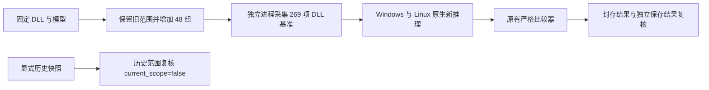

# OneOCR 联合参数覆盖续接报告

2026-11-04，用户按交接文档启用 reverse-skill，随后明确优先扩大输入与参数覆盖。Windows/Linux 全新原生回归各 **269/269**，合计 **538/538**；其中 532 项识别输出、6 项预期拒绝。CTest 各 26/26，Python 完整套件 67/67。新增用例未发现需要修改生产算法的差异，完整跨平台目标仍 incomplete。

本报告按 reverse-skill 的 docs-generator 与 diagram-generator 流程生成，采用普通兼容性逆向结构（flavor=null）。[scope](../research/parameter-expansion/scope.md) 限于本地固定 DLL/模型、源码及测试，授权不扩大为 push、公开发布或上传。工具版本为 reverse-skill cab634bd、既有 Ghidra 11.3.2 / JDK 21.0.8+9；本轮复用已有静态锚点，未重新反编译或声称新张量逐字节证明。

## 扩展范围与发现

参数由 67 组增为 115 组：32 组旋转真实中文手写联合参数、12 组阿拉伯文/希伯来文/天城文/泰文打印参数、4 组多栏/竖排参数。保留 126 张图片、27 项固定语料及书页，共 269 项/端。新增 48 组中原 DLL 有 46 组非空、2 组合法空结果，全部参与验收。没有增加图片来源或书写者；真实手写来源沿用原 provenance。

Photos 2026.11090.22001.0 / OneOCR 11.0.15 的全部 269 项基准在独立进程重新采集；旧 221 项又与本次 DLL 输出逐字段核对通过。原生复用已验证二进制，未重建，也未改变固定模型或比较器。严格阈值仍为坐标 1px、角度 0.1°、置信度 1e-3，其余字段按既有契约一致。

旋转图与软行预算交集继续验证既有 Photos `0x180497500`、`0x180490ca0`、`0x1804a4c90` 路径；例如多栏 max_lines=1 返回四行，不能硬截断。上述地址属于已有研究锚点，本轮结论来自新 DLL 与原生输出观测。

## Evidence → Finding → Path

| Evidence | 原始记录 | 关联结论 |
|---|---|---|
| E-001 | 接手包身份与历史 442 项保存结果复核 | F-001：固定基准和原范围得到保留 |
| E-002 | 48 组联合参数及 269 项 DLL 重采，旧 221 项复核 | F-001：联合覆盖扩大，未增加书写者 |
| E-003 | Windows/Linux 新推理、CTest、Python 原始结果 | F-002：538 项原生通过；F-003：历史快照不会冒充当前范围 |

逐项 artifact SHA-256、复现命令、Finding 字段和 Path P-001 见[案件证据链](../research/parameter-expansion/report/findings.md)及同目录 evidence。时间线见[案件 timeline](../research/parameter-expansion/timeline.md)。

默认保存结果复核继续要求当前全部 269 项。历史模式必须指定 `--reference research/references/options-handwriting-2026-11-03.json`，输出 current_scope=false；Python 反例证明旧 221 项报告默认无法通过当前验收。Wasm 新推理拒绝历史快照，原生新推理不提供此参数。历史五环境复核只是读取已有输出，不是新的 Wasm 推理或原生门槛。

## 复现与剩余工作

完整命令、资产 SHA-256、逐项输出及索引见[执行报告](../reports/parameter-expansion-2026-11-04/README.md)。Windows 用 `python scripts/run-native-parity.py --binary artifacts/win32-x64/bin/ocr.exe --output work/fresh-expanded-windows`；Linux 用同一脚本与 artifacts/linux-x64/bin/ocr。本轮 Linux 在独立网络命名空间运行。

旧报告和索引未改。源码及报告本地提交后刷新离线包，以当前 HEAD 和 artifacts/OFFLINE_PACKAGE.json 核对最终身份。原生算法、阈值和模型未改；Wasm 新范围未测。Linux ARM64、macOS x64/arm64、Android arm64-v8a 仍未验证，更多自然手写、书写者和文字类别有缺口。建议下轮针对这些缺口继续登记输入并以同版本原 DLL 建基准。
