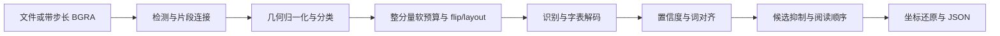

# OneOCR 原生源码项目交接文档

编写日期：2026-11-03，Asia/Shanghai。适用仓库：`win11-oneocr`；本机路径：`F:\pythonx\myocr\win11-oneocr`；当前工作分支：`research`。

本文依据当前可见会话、Git 提交、源码、模型清单、封存报告和交付侧车整理。**编写前已核验的代码/资产基准为 `66411882e88296b9dbcd9caace79b71c69099106`。** 本文加入仓库后会产生文档提交，不能将这个基准误认为永远最新的 HEAD；最终包身份以 `git rev-parse HEAD` 与 `artifacts/OFFLINE_PACKAGE.json` 为准。

本文为继续开发与换机接手提供入口，不替代根目录 `AGENTS.md`，也不替代原始执行数据。本次交接工作的核验属于文档和身份核对；最近一轮完整新推理仍是下述已封存的原生 442 项执行。

## 1. 接手者先读的结论

1. **原生 C++ 为验收主线。** Windows/Linux 原生最近一轮分别全新执行 221 项，均通过原 DLL 严格比较，合计 **442/442**；其中 436 项为识别输出，6 项为原有预期拒绝。
2. **JS/WebAssembly 不再要求绝对一致，也不阻塞原生验收。** 用户已明确调整标准并再次确认继续使用原来的数值阈值；不得恢复成“五环境必须同时绝对一致”的门槛。
3. **“绝对一致”不指另设零误差。** 文字、切分、顺序、类型等按既有契约一致；坐标 ≤1px、角度 ≤0.1°、置信度 ≤1e-3。不可自行放宽阈值、换模型或豁免失败输入。
4. **最新 Photos 交集测试 P2 已修复。** Windows/Linux CTest 各 26/26，包含 13 个负例和 3 个边界正例；Python 完整套件 65/65。原始 `1e9` 错误场景现在使默认测试进程退出 1。
5. **换机摘要问题也已修复。** 严格比较器被 `.gitattributes` 明确设为 `-text`，Windows CRLF 转换不再改变其已冻结的原始摘要。
6. **整体仍为 incomplete。** Linux ARM64、macOS x64/arm64、Android arm64-v8a 原生构建/运行未验证；更多参数、书写者和手写文字类别仍有覆盖缺口。有限回归通过不能证明任意输入完全等价。
7. **本地提交与离线交付已获授权；push、公开发布和上传模型没有获授权。** 本会话未执行这些外部发布动作。

最短阅读顺序：

| 顺序 | 文件 | 用途 |
|---|---|---|
| 1 | `AGENTS.md` | 后续所有开发与 Review 必须遵守的铁律 |
| 2 | `docs/acceptance-standard.md`、`research/acceptance-policy.json` | 人工和机器可读的当前标准 |
| 3 | `reports/photos-intersection-p2-2026-11-03/README.md` | 最新原生新推理、P2 修复与负例 |
| 4 | `reports/photos-intersection-review-2026-11-03/README.md` | 最新 442 项保存结果独立复核 |
| 5 | `reports/photos-intersection-checkout-2026-11-03/README.md` | CRLF 摘要漂移与换机保护 |
| 6 | `research/delivery-manifest.json`、`artifacts/OFFLINE_PACKAGE.json` | 运行资产、活动基准和最终包身份 |
| 7 | `docs/portable.md`、`docs/error-codes.md` | 构建、API、错误语义 |

## 2. 原始目标与已确认边界

用户最初要求保留微软 OneOCR 原模型，重建可从源码编译的 C++ 引擎，最终支持 Windows、Linux、Android、macOS，并提供 JS/WebAssembly 版本。目标功能包括文字识别、行/词四边形、置信度、图像角度、手写类型、现有选项与 JSON 字段，以及插件调用行为。

“纯源码”的已确认含义：引擎与运行依赖有源码构建流程，允许独立模型权重；本轮不重建训练数据和训练流程。正式识别不需要 Python、Windows OCR DLL、账号、证书或激活服务。研究和构建阶段可以使用 Python、Ghidra、原 DLL 与本地工具。

“无证书许可限制”的执行含义是无需在线授权/激活服务；**并未改变微软模型的权利归属**。模型不是 MIT；项目源码、依赖、模型、样本图片各自保留来源与许可。原生 C++ 及接口采用项目既有 MIT 声明；独立准备工具 `scripts/unpack-onemodel.py` 有单独 AGPL-3.0-only 来源与标识，不能把它的许可笼统套到所有引擎文件，也不能把项目 MIT 套到模型。

依据见 `THIRD_PARTY_NOTICES.md`、`licenses/` 与各样本 provenance。准备后的资源已按用户要求放入本地 Git，未由此推断额外再分发许可。

## 3. 当前验收铁律

用户原话：“只要逆向的 C++ 版本和原版绝对一致就可以了。网页汇编不用绝对一致。”随后回答数值口径为：“沿用此前严格阈值”。

| 项目 | 当前要求 |
|---|---|
| 基准 | 同模型版本、同图像、同参数的原微软 DLL；不可用参考 Python 的估算输出替代 |
| 必须一致 | 文字、阅读顺序、行词切分、手写类型、计数、索引、既有字段语义 |
| 坐标最大误差 | ≤1px |
| 图像角度误差 | ≤0.1°；沿用既有循环角度比较 |
| 置信度误差 | ≤1e-3 |
| 字段合法性 | 拒绝 NaN/Inf、非法类型、非法范围、错误计数和索引 |
| 排除的宿主差异 | 沿用比较器对 `file` 路径和后端 `engine` 元数据的既有排除规则 |
| C++ 范围 | 所有登记样本、语料、书页及参数；预期拒绝单独验证 |
| Wasm | 不要求绝对一致；差异与功能错误如实记录，不作为原生识别门槛 |
| 平台结论 | 每个平台分别报告“构建通过”“运行通过”；未实测不能标通过 |
| 历史证据 | 封存报告与索引不得改写；补充结论另建报告 |

权威比较器为 `scripts/compare-results.py`。其 SHA-256 固定为：

```text
06d137cc93680f766031d783da9526064808fea1135124348e180bb8607f4869
```

不要将“Wasm 非门槛”解释为允许修改 C++ 阈值，也不要另创未经用户确认的 Wasm 数值容差。取消、超时、资源释放等功能契约仍须如实测试和报告。

## 4. 当前版本、资产与依赖身份

### 4.1 活动原 DLL 和模型

当前对照是 Photos `2026.11090.22001.0`，OneOCR DLL 版本 `11.0.15`。研究对照目录为 `bin/photos-2026.11090.22001.0/`。

| 资产 | SHA-256 |
|---|---|
| `oneocr.dll` | `0a5e99041af902d6825f0af04ab25e62d2e2378ace69d10175f0dcc22816aae0` |
| `oneocr.onemodel` | `f6cef38b839012cd824abf8b854ee9fa4f87d4c5265440661d66b23f4fab5155` |
| 原 `oneocr_wrapper.dll` | `1e9027763cf23f144dd84f3a1a83ab067bbb9d0401934c36741315ff9a42a2a7` |
| Photos 配套 `onnxruntime.dll` | `bf14eb254d0a3fe50abe55b341d70abdbbf9bd4affd810998a86fac9ef81fc69` |
| 正式 `models/manifest.json` | `8e6d5b973aad14590890ce78de39e5414b7297df4350d65e7a2990ab9b9c929a` |
| 参数清单 `research/parameter-cases.json` | `b9ccc9bdaad3c0037bd0384b586a800228ff61d99a2956e565447bbb07b0e326` |

用户给过的系统来源路径是：

```text
C:\Program Files\WindowsApps\Microsoft.Windows.Photos_2026.11090.22001.0_x64__8wekyb3d8bbwe\oneocr.onemodel
```

正式运行使用仓库 `models/`；不要改为运行时访问 WindowsApps。旧 9.0.103 DLL/模型仍保存在 `bin/` 与 Git 历史，不能因为在那里发现另一个 `.onemodel` 就替换活动版本。

活动路径选择由 `research/delivery-manifest.json` 的 `reference` 明确绑定。原始基准位于：

```text
reports/options-handwriting-2026-11-03/reference/legacy/
reports/options-handwriting-2026-11-03/reference/corpus-legacy/
reports/options-handwriting-2026-11-03/reference/book-legacy.json
reports/options-handwriting-2026-11-03/reference/parameters/
```

### 4.2 不要混淆三个计数

- `models/` 当前有 **155 个已跟踪文件**，包含准备后的图、词表、元数据、校准等。
- `research/delivery-manifest.json` 绑定 **252 个模型/运行资产文件**。
- 参数矩阵有 **67 组**；这不是模型文件数，也不是总回归项数。

模型图角色、输入输出、词表和映射以 manifest 和 preparation 合约为准，禁止按体积猜测，禁止用缺省字表静默替代。较早研究中的资源/图统计与这三个交付计数含义不同，应保留上下文。

### 4.3 固定依赖

| 组件 | 固定版本/提交 | 说明 |
|---|---|---|
| ONNX Runtime | v1.23.2，`a83fc4d58cb48eb68890dd689f94f28288cf2278` | 正式 CPU 后端，有源码构建流程 |
| Photos ORT | 1.24.20260504.1.7444c45 | 仅原 DLL 对照的配套运行库；不是正式 ORT 1.23.2 构建 |
| OpenCV | 4.10.0，`71d3237a093b60a27601c20e9ee6c3e52154e8b1` | core/imgproc 源码静态集成 |
| ICU | 74.2，`2d029329c82c7792b985024b2bdab5fc7278fbc8` | Unicode、双向文本和泰语词典数据 |
| reverse-skill | `cab634bd855fc287f6e420c1f36fd1a6b9245960` | R22 / Ghidra 离线样本流程 |
| Python 参考项目 | `75cc12666503425ffd6ea0cb052c0bcaaff21058` | `bropines/oneocr-onnx-python`，研究参考而非完整替代品 |
| Ghidra / JDK | 11.3.2 / Temurin 21.0.8+9 | 研究工具 |
| Emscripten / emsdk | 4.0.8 / `419021fa040428bc69ef1559b325addb8e10211f` | 既有 Wasm 构建工具链 |

版本锁定入口：`research/dependencies.json`、`scripts/requirements-lock.txt`。非 MSVC 构建保留 `-ffp-contract=off`，源码中显式 FMA 仍保留。历史官方 Linux 预编译 SDK 曾出现严格差异，不能因能加载就替代已验证的源码 ORT；对应失败证据保留在旧研究记录。

## 5. 会话演进与关键提交

### 5.1 研究主线

会话经历了原生引擎还原、完整资产入 Git、新 Photos 模型对照、错误码文档、Wasm、严格比较器和缓存身份增强、多轮 Review 修复、退化曲线/极长行分支、NaN 词框/源码 ZIP 索引、真实中文手写/参数矩阵，以及最新 Photos 交集断言。

早期 C++ 能力并非直接拷贝参考 Python：参考项目处理流程存在缺失，原生实现补齐了原 DLL 的检测、几何、字表映射、分类、词对齐、阅读顺序、置信度、手写与方向等环节。未完成范围持续标记，而非用其他 OCR 模型代替。

### 5.2 本轮附近的提交

| 提交 | 内容 | 接手时的含义 |
|---|---|---|
| `cb80896` | 词框非有限值拒绝与完整打包封存报告 | 历史两个 P2 的修复入口 |
| `dfa477b` | 参数组合、真实中文手写与处理还原 | 行预算、粗筛、flip/layout、置信度等生产处理修复 |
| `0dbc2bb` | 五环境全量报告与资产封存 | 221×5=1105 的历史新推理证据 |
| `31a0649` | 记录当前验收铁律 | C++ 严格、Wasm 非门槛；用户确认沿用旧阈值 |
| `75cc751` | 修复 Photos 交集断言及超差/非有限值负例 | 最新原生回归绑定的实现/测试提交 |
| `af158bf` | 原生全量与独立复核报告 | 221×2=442、CTest 26×2、Python 65 |
| `6641188` | 固定比较器原始字节身份 | Git CRLF 换机问题的补充修复；本文编写前核验基准 |

本次交接文档的提交位于这些提交之后。找最终交付身份时，不要凭这张历史表猜 HEAD。

## 6. 已还原处理与代码地图

| 位置 | 作用 |
|---|---|
| `native/src/engine.cpp` | 模型加载、识别总流程、词输出、分类/置信度/坐标组合、C ABI 边界 |
| `native/src/detector.cpp`、`fragment.cpp` | 检测、片段连接、区域几何 |
| `native/src/normalizer.cpp` | 曲线/四边形归一化、备用求解、宽度裁剪、词框逆映射 |
| `native/src/classification.cpp` | 文字类别、手写、flip 和全局歧义处理 |
| `native/src/confidence.cpp` | CTC 特征与置信度相关处理 |
| `native/src/alignment.cpp` | 词帧和坐标对齐 |
| `native/src/ordering.cpp`、`ordering.hpp` | 原生排序与阅读顺序 |
| `native/src/recognition_budget.hpp` | 软行预算与整分量分批 |
| `native/src/nms.cpp` | 包围框粗筛、多边形交集、覆盖、候选方向抑制 |
| `native/src/unicode.cpp` | Unicode、双向文本和语言相关处理 |
| `native/src/trace.hpp` | `ONEOCR_TRACE_DIR` 研究追踪；默认识别不写张量 |
| `native/src/cli.cpp`、`windows_compat.cpp` | 原生 CLI 与 Windows 旧接口适配 |
| `native/include/oneocr_portable.h`、`.hpp` | C ABI 和 C++ RAII 接口 |
| `native/android/` | JNI/Java 示例；不是已验证 Android 交付 |
| `web/`、`artifacts/wasm32/` | Wasm 的源码包装、Worker、类型声明和已有运行资产 |
| `src/index.js` | DSH 插件，调用原生/legacy/Wasm 入口 |



### 6.1 参数和真实中文手写暴露的四处处理

1. **软行预算。** 先去掉 nontext，按原生整数外接框排序，将异轴相交分量作为完整分组。批量为 `max(4, trunc(round(remaining)*1.1))`；每批识别并抑制方向候选后再判断预算。不能识别后硬截成 N 行。
2. **NMS 粗包围框门控。** Polygon IoU 之前仍有 floor/ceil、包含 +1 边界的整数包围框粗筛。遗漏它曾让手写局部框压掉整行。
3. **CJK layout 在 flip 后。** 先做 180° flip 校正，再运行版式网络；原位置错误曾导致角点循环顺序和阅读顺序差异。
4. **方向候选置信度。** 使用输出词置信度按 UTF-8 字节数加权，float 乘法后 double 累加，不是粗词组拒识概率。

证据入口：`research/options-handwriting/README.md`、`oracles/index.json`、`report/findings.md`、`docs/2026-11-03_reverse-oneocr-options-handwriting-report.md`。六份原始 oracle 绑定了工具、图片、DLL/模型及冻结输出。特定 grid-10 样本有 **95 次 classifier/recognizer/layout 调用**的输入/输出逐字节匹配记录，不应将它夸大成所有模型、所有图像的张量证明。

### 6.2 曲线备用求解、极长行和最终词框

- 退化曲线保留原 LU 顺序和零主元决策，备用分支为 SVD 正规方程求解；没有用任意 epsilon 替换原决策。
- 极长多边形按原行为裁剪目标宽度、保留源顶点、覆盖全部三角形，并还原裁剪词框的逆映射与 flip。
- 极长行初始差异还定位到小面积比例下的 AREA 插值；算法常量不等于验收阈值。
- 最终词框测试显式检查 actual/golden 的有限性：48 个非有限值负例、8 个有限但超差负例；内部词框 oracle 的 0.0001px 检查与外部 OCR 1px 标准不是同一层。
- 某些原始内部几何控制流有意借 NaN 决定分支；这不代表允许最终词框 NaN。不要全局清理 NaN 并改变原算法。

对应证据：`research/curve-boundaries/`、`reports/curve-boundaries-2026-11-03/`、`reports/word-box-zip-p2-2026-11-03/`。

### 6.3 最新 Photos 交集测试 P2

问题位于 `native/tests/nms_test.cpp`，不是生产识别算法换模型。旧 Photos 路径只更新最大误差，没有让超差增加失败数；`abs(NaN) > tolerance` 也不能拒绝 NaN。

修复：旧 oracle 和新增 Photos oracle 共用 `check_intersection`，实际值、期望值、差值都必须有限，误差不得超过原有 `.01f` 面积容差。错误进入失败计数，默认测试进程最终退出非零。

| 测试类别 | 覆盖 |
|---|---|
| 13 个负例 | 正/负方向刚超容差、Review 的 1e9 差值、actual NaN/+Inf/-Inf、expected NaN/+Inf/-Inf、双 NaN、同号双 Inf、有限数相减溢出 |
| 3 个正例 | 正/负方向恰好 `.01f`、相等的大有限数 |

这些用例把标量注入第一项真实 Photos 对，经过真实检查路径；不改冻结 oracle，也不改几何输入。负例命令退出 0 表示“恰好检出了预期错误”，并非接受错误值。另有不带负例参数的默认进程复现：正常退出 0，孤立 oracle 的期望面积改错 1e9 后退出 **1**。

两端默认 NMS 都检查 **54,748 项多边形 probe、79 组识别 NMS**，面积最大误差 0。原 10 项 CTest 加新增 16 项后，各为 26/26。

### 6.4 CRLF 字节身份问题

第一次从 `af158bf` 交付包干净检出后，Git 把比较器 LF 改成 CRLF。原生识别通过，但新的保存结果复核正确地报 `Comparator changed`。这不是数值差异，也没有通过改摘要绕过。

`6641188` 增加 `/scripts/compare-results.py -text`。Git 过滤在 `core.autocrlf=true/false` 下均输出原 SHA-256 `06d137...f4869`，新 bundle 干净检出后 442 项复核通过。报告另存于 `reports/photos-intersection-checkout-2026-11-03/`，先前封存主报告没有改写。

## 7. 回归范围与样本来源

### 7.1 当前范围

| 组成 | 数量 | 注册位置 |
|---|---:|---|
| `samples/` 下全部登记图片 | 126 | `samples/manifest.json`，递归清单，不能漏缩略图/参考图 |
| 固定语料 | 27 | `research/case/corpus/manifest.json` |
| 书页 | 1 | `ocr-book.jpg`；当前模型 106 行，旧模型历史为 105 行 |
| 参数组合 | 67 | `research/parameter-cases.json` |
| 每端合计 | **221** | `scripts/regression_inputs.py` 汇总与指纹校验 |

67 组中 **66 非默认＋1 完整默认对照**。组成是：打印十二行图 11 种行预算 × 5 种尺寸共 55；两张真实手写各 3 组共 6；零别名 2；空白边界 4。它是有限矩阵，不是所有整数参数穷举。

原生每端 218 个识别输出、3 个预期拒绝。两个图高度不足 50，原接口拒绝 `-18`；一个 LA 双通道图拒绝 `-15`。不要删除、补边、转码或缩放后仍冒称同一原始测试通过。业务显式转换应登记为新输入。

### 7.2 真实中文手写新增资产

位置：`samples/options-handwriting/`，共 12 张：

- 两张真实纸面中文手写照片：`red-grid-jason.jpg`、`red-calligraphy-jason.jpg`。
- 每张 90°/180°/270°/10° 共八张变换图；前三类为无损像素 transpose，10° 为 BICUBIC、expand、白填充。
- 十二行打印图和空白图两个控制项；它们不是手写样本。

摄影者为 jason hu（@hujason），两张来源页：

- https://unsplash.com/photos/red-chinese-characters-handwritten-on-white-paper-7SFlf90CNic
- https://unsplash.com/photos/handwritten-chinese-calligraphy-on-grid-paper-5oLLnT9lxIU

完整来源、发布日期、Unsplash License、CDN 下载地址、SHA-256、变换方式在 `provenance.json`。交付是 width-1600 CDN 图像版本，不冒称相机原片；书写者没有被摄影者单独标明，不能宣称多书写者覆盖。

真实手写也可能被原 DLL 输出为 printed；验收要求复现原 DLL，不是强行改标签，也不是以人工转写衡量准确率。生成打印控制项使用的字体没有再分发，provenance 保存其文件摘要。

## 8. 当前证据与平台状态

| 记录 | 性质 | 实测结果 | 当前用途 |
|---|---|---|---|
| `reports/photos-intersection-p2-2026-11-03/` | 最新 Windows/Linux 原生新推理 | 各 221/221，共 442/442；436 识别＋6 拒绝 | 当前原生验收主证据 |
| `reports/photos-intersection-review-2026-11-03/` | 保存结果独立复核 | 442/442，`fresh_inference=false` | 不能重复计为新推理 |
| `reports/photos-intersection-checkout-2026-11-03/` | Git 过滤/换机身份补充 | 比较器原始摘要在两模式下保持一致 | 不改写原主报告 |
| `reports/options-handwriting-2026-11-03/` | 之前五环境新推理 | 221×5=1105/1105；1090 识别＋15 拒绝 | 历史证据，不再是联合门槛 |
| `reports/curve-boundaries-2026-11-03/` | 更早曲线/长行新推理 | 142×5=710/710 | 旧输入范围，不冒充当前全量 |
| `reports/word-box-zip-p2-2026-11-03/` | 旧 P2 与保存结果复核 | 710 项复核、当时 Python 58 | 不冒充新推理或当前测试数 |

最近一轮 Python **65/65** 包括新增原生验收入口的反例：原生坐标超差必须失败、成功/错误输出冲突须拒绝、Wasm 诊断差异不阻塞原生。

最新主报告索引 SHA-256：

```text
a051437f6a0411efaffcb3f4a0d19ad9ee521c3922a4b9f2e623aa0973719f59
```

Windows 详细 CTest 日志的本地化日期头是 GB18030，Linux 为 UTF-8；原始字节保留，编码在 `evidence/unit-tests.json`。不要因 UTF-8 解码失败而改写封存日志。

| 原生平台 | 构建 | 运行 |
|---|---|---|
| Windows x64 | 已验证 | 最新 221/221 |
| Linux x64，Ubuntu 26.04 / WSL2 | 已验证 | 最新断网命名空间 221/221 |
| Linux ARM64 | 未验证 | 未验证 |
| macOS x64/arm64 | 未验证 | 未验证 |
| Android arm64-v8a | 未验证 | 未验证；Java 示例编译不等于原生/真机验证 |

最近 Wasm 只在 Windows Node 24.14.0 对两项输入做诊断，2 项都匹配旧严格比较器，但不是新构建或完整集验收。保留资产的 `BUILD.json` 仍如实记录先前测试/CMake 源码快照；不要手改 manifest 伪装为新构建。Safari、Firefox、移动浏览器和 Node 20 全范围仍未验证。

### 8.1 性能数据的正确读法

最新两端 221 项 CLI 逐项启动的记录如下；包含启动耗时且主机负载不同，不应当作跨平台吞吐基准：

| 环境 | 逐例耗时之和 | 中位耗时 | 单例最大耗时 | 最大进程峰值字节 |
|---|---:|---:|---:|---:|
| Windows 原生 | 220.065s | 0.835s | 6.936s | 395345920 |
| Linux 原生 | 347.225s | 1.440s | 7.595s | 414146560 |

原始值在主报告 `evidence/performance.json`。逐例总和不是并发墙钟时间；浏览器多个进程峰值之和也不能声称为同时总峰值。

## 9. 源码、运行资产与忽略缓存

| 路径 | 内容/使用方式 |
|---|---|
| `native/`、`cmake/` | C++20 核心、C ABI/RAII、测试、JNI 和各目标配置 |
| `scripts/` | 依赖获取、模型准备、观测、回归、校验与打包 |
| `models/` | 正式独立模型资源；只使用统一入口，不随平台重复拷贝入 Git |
| `artifacts/win32-x64/` | 已验证 Windows CLI/动态库/CRT/头文件与 BUILD 指纹 |
| `artifacts/linux-x64/` | 已验证 Linux CLI/动态库/GCC runtime/头文件与 BUILD 指纹 |
| `artifacts/wasm32/` | 既有 Wasm、JS、Worker、类型声明与原构建指纹 |
| `bin/`、`bin/photos-2026.11090.22001.0/` | 保留的原始对照；不是正式原生引擎依赖 |
| `research/` | 活动清单、合约、静态/动态 oracle、案件证据与历史状态 |
| `samples/`、`reports/` | 全部登记输入、来源和各轮封存证据 |
| `web/`、`examples/wasm/`、`src/index.js` | Wasm 包装/示例与 DSH 插件 |
| `work/`、`build/`、`.research-python/`、`node_modules/` | 忽略的缓存/工具/环境；不要假定换机会保留 |

`research/verification.json` 中多个 phase/history 对象是历史状态。最新主入口为 `active_native_regression_report`；`delivery-manifest.json.verification_archive` 仍指向旧五环境归档供历史验证测试使用，不能随手改成只有两个原生目录的新报告，否则旧测试会找不到 `windows-node/`。

正式运行可以离线、无需研究环境；但**离线运行包不等于离线完整编译工具链包**。`work/vendor/` 的 Ghidra/JDK、ORT/OpenCV/ICU 源码和构建缓存不随 Git 交付。重建需要按锁定版本准备工具链/源码，通常首次获取需要网络；不能据此说正式 OCR 需要网络。

## 10. 接口、参数与错误语义

### 10.1 原生 API

头文件为 `native/include/oneocr_portable.h`，入口包括 `oneocr_create`、`oneocr_recognize_file`、`oneocr_recognize_bgra`、`oneocr_destroy`、`oneocr_free`、`oneocr_capabilities`。C++ 封装为 `oneocr::Engine`。

- 路径为 UTF-8；识别结果和错误字符串必须用 `oneocr_free` 释放。
- 失败时 JSON 输出应置空，不得沿用上次成功数据；极端内存不足时错误文本也可能为空，应以整数状态为主。
- 每个实例内部串行化其推理调用；不同实例可并发。销毁前必须等待识别结束，非空句柄不能重复销毁。
- BGRA 支持填充步长，需要 `stride >= width*4`、`data_size >= (height-1)*stride + width*4`，有溢出检查，不接受负步长；Alpha 不参与识别。
- `oneocr_capabilities` 为借用的静态字符串，不能传给 `oneocr_free`。
- 异常不跨 C ABI；RAII 当前通过异常文本报告，不保留全部整数码。

### 10.2 易错参数

- `max_lines=0` 对应默认 1000，其余允许 1..1000。
- **max-lines 是软批次预算**。十二行控制图设为 1..4 可返回四行，设为 11 可返回十二行；这是原 DLL 行为，不是超限 bug。调用方需要硬截断展示时应在结果层自行处理，不应混入兼容性输出。
- resize 宽高同时为 0 对应 1152×768，不能只把一维设为 0。
- 原生 API 现有有效范围 32..8192 为扩展；固定 Photos DLL 的共同上限为 1152×768，原包装层超限返回 `-20`。共同范围之外不声明原 DLL 输出等价。
- 零别名的原始对照明确使用有效默认参数；不要宣称与 raw wrapper 不调用 resize setter 的行为完全相同。

### 10.3 错误入口不可混用

完整说明在 `docs/error-codes.md`。原生 C ABI 当前码为：0 成功、-12 参数、-13 图像、-15 通道、-18 尺寸、-19 分配、-30 标准异常类、-31 ORT/未分类异常类。

`-30` 不仅代表模型损坏，也可能是其他标准异常，必须保存 error 文本。OneOCR 私有状态、包装 DLL `OCR_ERR_*`、原生码、ORT 公开码、系统加载器异常不是同一套编号，不能互相套用。CLI 对外退出 0/1，错误在 stderr；空白图的空结果是成功。

原包装 DLL 位于 `bin/.../oneocr_wrapper.dll`，原生兼容适配也叫 `artifacts/win32-x64/bin/oneocr_wrapper.dll`。不要因为文件名一样就混用。

### 10.4 DSH 插件

`src/index.js` 默认 `backend: 'portable'`；有效值是 `portable`、`legacy`、`wasm`，不是 `'native'`。`ocrBin`、`modelDir` 可显式覆盖。默认超时 60000ms、输出限制 4MiB，保留取消、进程树结束、结果文件大小检查和 JSON 解析行为。

插件宿主需要 Node 和锁定的 npm 依赖；这不等于原生 CLI 需要 Node。legacy 仅 Windows，且默认旧 `bin/ocr.exe` 不应被假定为当前 Photos oracle；版本对照用明确的 `run-legacy.py --binary-dir`。

## 11. 运行、构建与回归操作手册

除本机绝对路径示例外，以下命令均在仓库根执行。每次推理/复核输出目录必须是新的空目录；保留旧失败与旧执行，不要覆盖成 PASS。

### 11.1 换机直接运行

```powershell
.\ocr.cmd .\ocr-book.jpg --text
.\ocr.cmd '.\samples\options-handwriting\red-grid-jason.jpg' --quiet --output work\handwriting.json
```

```sh
./ocr.sh ./ocr-book.jpg --text
```

Windows x64 需要系统 UCRT，VC release CRT 已随安装目录保存；现有 Linux x64 包要求 **glibc ≥2.43**，实测 Ubuntu 26.04。更旧 Linux 应在目标系统源码构建，不应替换系统 glibc。

```powershell
python scripts/verify-delivery.py
```

该命令用标准库核对 252 个模型/运行资产，并从无关工作目录识别书页、严格匹配当前 106 行。`--all-samples` 会增加 126 张样本检查，**不等于含 27 语料和 67 参数的完整 221 项验收**。

### 11.2 本机已有构建缓存

Windows 本机 CMake/CTest 实际安装路径为：

```text
C:/Program Files/Microsoft Visual Studio/2022/Community/Common7/IDE/CommonExtensions/Microsoft/CMake/CMake/bin/
```

若已加入 PATH：

```powershell
cmake --build build/source-runtime --config Release --parallel 6
ctest --test-dir build/source-runtime -C Release --output-on-failure
python scripts/stage-runtime.py --build build/source-runtime --prefix artifacts/win32-x64 --shared-models
```

Linux 已有缓存：

```sh
cmake --build build/linux-x64 --parallel 6
ctest --test-dir build/linux-x64 --output-on-failure
python3 scripts/stage-runtime.py --build build/linux-x64 --prefix artifacts/linux-x64 --shared-models
```

首次源码构建参照 `docs/portable.md`。Windows 可先运行 `scripts/bootstrap-research.ps1`，再运行 `scripts/build-native.ps1 -SourceRuntime`；Linux 需准备固定 ORT、OpenCV 和 ICU 数据。源码准备目录默认受活动模型身份保护，研究其他版本必须显式选新目录，不能覆盖正式模型。

最近封存记录的本机环境为 Windows 10 x64（系统版本 10.0.19045）、MSVC 19.44.35227.0、CMake 3.31.6-msvc6；Linux 为 Ubuntu 26.04 LTS / WSL2、GNU 15.2.0、CMake 4.2.3、Python 3.14.4。Windows 研究 Python 的 bootstrap 版本为 3.12.8。Node 为 24.14.0，历史浏览器为 Chrome 156.0.8078.79。它们是已测环境身份，不代表其他系统/编译器已经通过；详细记录见 `reports/options-handwriting-2026-11-03/evidence/environment.json`。

### 11.3 真正的原生完整新推理

```powershell
python -X utf8 scripts/run-native-parity.py --binary artifacts/win32-x64/bin/ocr.exe --output work/handoff-native-windows-new
```

```sh
python3 scripts/run-native-parity.py --binary artifacts/linux-x64/bin/ocr --output work/handoff-native-linux-new
```

本机断网 Linux 验证使用 `wsl -d Ubuntu -u root -- bash -lc 'cd /mnt/f/pythonx/myocr/win11-oneocr && unshare --net -- python3 ...'`。命令中的工作路径需随新机器调整；`unshare --net` 需要对应权限。

### 11.4 保存结果独立复核与测试

```powershell
python -X utf8 scripts/verify-native-results.py --report reports/photos-intersection-p2-2026-11-03 --output work/handoff-native-saved-review-new
python -X utf8 scripts/run-python-tests.py --report work/handoff-python-tests-new.json
python -X utf8 scripts/verify-layout-witness.py
```

第一条不执行推理，验证原始资产、模型、运行文件、输入/参数/基准身份、结果文件和严格字段，合计 442；Wasm 数值差异不进入原生通过判定，已归档文件完整性仍检查。第二条完整套件当前应为 65 项。测试文件名有连字符，普通 unittest discover 曾只发现 0 项，必须使用专用 runner；`--without-archives` 只是诊断，不可称完整测试。

第三条仅验证保存的紧凑 flip/layout 张量，标准库可运行，不是新推理。大张量重采集命令见历史报告的 `evidence/flip-layout-witness/README.md`。

Linux/Ninja 复现 Photos 默认退出：

```sh
python3 scripts/reproduce-nms-oracle-rejection.py --output work/handoff-photos-mutation-new
```

该工具复制 oracle 并只在新目录编译当前测试源码，不改跟踪源文件、正式 oracle 或现有构建输出。Windows/Linux 的 16 个测试场景均可通过 CTest 运行。

### 11.5 Wasm 诊断

```sh
node artifacts/wasm32/cli.mjs samples/options-handwriting/red-grid-jason.jpg --model-dir models --quiet --output work/handoff-wasm-diagnostic.json
```

它不是原生门槛。完整构建参照 `docs/wasm.md`、`scripts/build-wasm.py`。当前 Wasm 资产的测试/CMake 指纹是之前构建的快照，若脚本报告源码已变，应按事实重建或标为旧资产诊断，不能直接刷新指纹假装重建成功。

## 12. reverse-skill 与继续逆向

相关案件在 `research/case/`、`research/curve-boundaries/`、`research/options-handwriting/` 以及部分报告的 `case/` 子目录。应先阅读 scope、timeline、workitems、Evidence，再沿 Finding/Path 进入源码。R22 离线样本流程的产物保持项目本地。

本机工具：

```text
work/vendor/reverse-skill                     固定 cab634bd...
work/vendor/ghidra/ghidra_11.3.2_PUBLIC/support/analyzeHeadless.bat
work/vendor/jdk21/jdk-21.0.8+9                Ghidra JAVA_HOME
.research-python/python.exe                  Windows 研究 Python
build/source-runtime                        Windows 已配置构建
build/linux-x64                             WSL 已配置构建
work/ort-install、work/ort-linux-install      本机源码 ORT 安装缓存
```

这些路径是本机缓存，不是移机交付承诺。vendor 的 reverse-skill 工作树目前还含先前 field-journal `_index.md` 改动和一个未跟踪旧日志；不要因主项目 Git 干净就重置 vendor 子仓库，也不要把这些旧改动混成当前工作。

`scripts/research.py`、`capture-options-oracles.py`、`probe-photos-regions.py`、`photos_choice_observer.py`、`scripts/ghidra/` 提供重采集入口。动态观测在独立进程、版本检查之后进行，只修改研究子进程内的特定入口并恢复，原文件不改写。固定 RVA/对象偏移不能用于其他 DLL 版本；`--trace-geometry` 的旧版专用限制也不能随手去掉。

当前模型准备 `prepare-models.py` 为静态容器提取，不加载微软 DLL、不自动下载模型。重新准备应使用独立输出目录，先验证完整图/字表/映射和原始资源身份，再考虑切换；用户没有授权换用其他 OCR 模型。

## 13. 交付包、索引与提交流程

交付物均为提交后生成、被 Git 忽略的可再生产物：

| 文件 | 内容 |
|---|---|
| `artifacts/win11-oneocr-offline.bundle` | 当前 research 分支及完整历史，包含已提交模型、运行文件、源码、报告 |
| `artifacts/oneocr-source.zip` | 源码、样本、研究数据、报告、AGENTS；排除模型和编译文件 |
| 两份 `.sha256` | 各包实际摘要 |
| `artifacts/OFFLINE_PACKAGE.json` | 最终 HEAD、ref、长度、摘要、包验证；可能附提交后检出证明 |

本文编写前的 6641188 包已验证：源码 ZIP 有 12 份报告索引、12,340 个索引文件；Windows/断网 Linux 干净检出各核验 252 资产并识别 106 行书页，保存结果再复核 442/442，Git fsck 通过。**这不是在每次干净检出上又新跑整轮 221 项。** 本文加入后源文件数和包摘要会变化，以新侧车为准，不在本文硬编码会自引用的最终包摘要。

打包工具按所有 `reports/**/FILES.sha256.json` 收齐数据，包括 `.log.gz` 等非普通扩展，检查磁盘和 ZIP 内的长度/摘要。不能只验证自洽的 `SOURCE_BUILD.json` 就认定报告完整；`size`/`bytes` 旧索引格式需保持原样。

标准顺序：

```powershell
git status --short
# 完成代码、测试、资产、报告和文档的本地 commit，直到工作树干净
python scripts/package-offline.py
git bundle list-heads artifacts/win11-oneocr-offline.bundle
python scripts/package-source.py --verify artifacts/oneocr-source.zip
```

`package-offline.py` 要求干净检出，并在打包前后检查 HEAD/状态。包与侧车不能再嵌套提交进包含自身历史的 bundle，否则出现自引用循环。正常源码/样本/模型/运行资产/报告必须提交；最后包身份留在忽略的提交后侧车。

检查包对应当前 HEAD 的 PowerShell 示例：

```powershell
$package = Get-Content -LiteralPath artifacts/OFFLINE_PACKAGE.json -Raw | ConvertFrom-Json
$currentCommit = (git rev-parse HEAD).Trim()
if ($package.commit -ne $currentCommit) { throw 'Package HEAD is stale' }
foreach ($entry in $package.files.PSObject.Properties) {
    $packageFile = Join-Path artifacts $entry.Name
    $actual = (Get-FileHash -LiteralPath $packageFile -Algorithm SHA256).Hash.ToLowerInvariant()
    if ($actual -ne $entry.Value.sha256) { throw "Package SHA-256 mismatch: $($entry.Name)" }
}
```

移机时 `git clone -b research win11-oneocr-offline.bundle oneocr`，在新目录运行 `verify-delivery.py` 和原生保存结果复核。选新的检出和输出目录，不要删除现有证据。改了文档并再次 commit 后也必须刷新包，旧包即使识别正确也不再对应最新 HEAD。

## 14. 常见误判与排查顺序

| 现象 | 先检查 | 不应采取的动作 |
|---|---|---|
| `Comparator changed` | Git 状态、比较器原始 SHA、`git check-attr text -- scripts/compare-results.py` 是否 unset | 修改冻结摘要或绕过身份 guard |
| 当前输入范围不同 | 新增/删除图片、参数清单、源图 SHA、对应版本快照 | 漏跑输入或以旧 142 项报告冒充 221 项 |
| `max_lines=1` 返回四行 | 原 DLL 软批次预算与十二行控制图 | 在引擎里硬裁为一行 |
| 原包装层 resize `-20` | 是否超过共同 1152×768 范围，是否混淆零别名 | 宣称 8192 扩展也与原 DLL 等价 |
| 旧五环境复核找不到目录 | 是否把 legacy `verification_archive` 改成仅原生报告 | 为满足旧工具而把 Wasm 再设为验收门槛 |
| Python 测试“通过 0 项” | 是否误用了 discovery | 将零测试当成功 |
| Windows 详细日志 UTF-8 解码失败 | 日志编码是否 GB18030 | 重写已封存日志或索引 |
| Linux 程序加载失败 | glibc、架构、原生依赖、入口执行位与 lib 布局 | 自动换模型或无证据宣称该平台通过 |
| `-30` | 完整错误文本与阶段 | 仅凭码认定模型损坏并下载替代品 |
| Wasm 有数值差异 | 当前规则是诊断；核对实际构建与输入 | 阻塞 C++ 验收，或伪造 Wasm 通过 |

## 15. 未完成事项与建议接续顺序

### 已关闭的问题

- 退化曲线备用解、极长行归一化裁剪与词框逆映射：有直接分支 oracle 与历史全量证据。
- 最终词框 NaN 漏检与源码 ZIP 漏封存文件：有负例、变异和包索引验证。
- 非默认参数及真实中文手写引出的四处处理差异：有限范围内已严格回归。
- Photos 交集只统计误差、不导致失败：已加统一断言、13 负例/3 正例和默认进程复现。
- 比较器跨 Windows 检出原始字节漂移：已固定 -text，并有新 bundle 干净检出证明。

上述“关闭”仅指已记录问题和其验证范围，不声称任意输入、任意平台均已等价。

### 仍需继续

1. **原生目标平台验证。** 优先按用户下一步目标准备 Linux ARM64、macOS x64/arm64、Android arm64-v8a；分别记录依赖源码构建、引擎构建、目标运行、回归与资源数据。交叉编译成功不等于真机运行成功。
2. **更广输入/参数覆盖。** 更多真实书写者、自然手写风格、其他手写文字类别、参数联合场景和歧义分支。保留来源和许可，同版本原 DLL 生成基准。
3. **可复现环境完善。** 在不同 CPU/系统和新机器评估已锁定依赖，避免把本机缓存当作交付。现有离线运行包不承诺完整离线 SDK 重建。
4. **Wasm 按需诊断/构建。** 不作为前述原生事项的前置门槛；需要更新时真实重建并保留诊断差异。

接手后建议先验证规则、包身份和当前 442 项保存结果，再按明确任务修改。按变更影响及用户明确要求组织新的推理范围；纯文档交接本身不必重复完整推理，也不能把历史保存结果复核写成新推理。

## 16. 可复制给下一位接手者的任务摘要

> 工作仓库为 win11-oneocr，分支 research。先读 AGENTS.md、docs/acceptance-standard.md 和 docs/handoff-2026-11-03.md。用户铁律为 C++ 原生按原微软 DLL 严格对齐，继续使用坐标 1px、角度 0.1°、置信度 1e-3；不换模型、不漏样本、不放宽阈值。JS/Wasm 不要求绝对一致，其差异不阻塞原生。活动模型来自 Photos 2026.11090.22001.0 / OneOCR 11.0.15，模型 SHA f6cef38b839012cd824abf8b854ee9fa4f87d4c5265440661d66b23f4fab5155。当前范围 126 样本＋27 语料＋书页＋67 参数，每端 221 项。最新 Windows/Linux 新推理各 221/221，共 442/442；CTest 各 26/26，Python 65/65。Photos 交集 P2 已修复，含 13 个非有限/超差负例和三个边界正例；比较器 -text 保护已修复 CRLF 换机摘要问题。先核对 OFFLINE_PACKAGE.json 与当前 HEAD，再用 verify-native-results.py 复核最新原生保存记录。不要改写历史 FILES.sha256.json。Linux ARM64、macOS、Android 原生仍未验证，整体 incomplete。源码、资产、报告本地 commit，最终干净 HEAD 后刷新 bundle/源码 ZIP；没有 push、发布或上传模型授权。正式识别不需要 Python/原微软 OneOCR DLL/授权服务，模型权利声明不变。
