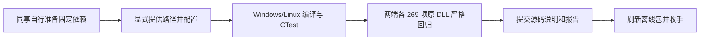

# 外部依赖构建交付与 Windows/Linux 严格回归

2026-11-04，按 reverse-skill cab634bd / R22 离线流程继续，遵照用户最新要求：依赖由同事自行取得和编译，不向 Git 新增大体积依赖包、预编译 SDK 或本轮编译二进制。源码、脚本、版本锁定、说明和本报告全部本地提交。

**本轮最终方案在干净源码目录成功构建 Windows/Linux C++，CTest 各 26/26；这次新编译的两端程序分别执行当前全部 269 项，合计 538/538 严格通过（532 识别输出、6 预期拒绝）。Python 完整套件 67/67。** 没有扩展样本、参数或平台，没有改 C++ 生产算法、模型或严格比较器。

## 同事如何编译

先按 [编译说明](../../docs/colleague-build.md)自行准备固定版本 ORT SDK、OpenCV/ICU Git 源码和 ICU 数据 C 文件。Windows 脚本新增 -OpenCvSource、-IcuData、-BuildDirectory，并保留 -SdkRoot/-IcuSource；也可通过环境变量供入。准备好依赖的 SDK 模式只执行 CMake 配置、编译和 CTest，不下载、不要求研究 Python 或 WSL。缺 SDK 时会明确报错，不自动引导依赖下载；对应负例见 evidence/missing-dependency.json。显式 -SourceRuntime 才进入原有完整依赖准备流程。

Linux 沿用 CMake 预设，所有依赖路径均显式给出。源码、版本锁定与既有模型已提交；依赖准备产物和新编译文件留在忽略目录。普通 git pull 需要团队远端先取得本地提交，或者从刷新后的完整离线 bundle 克隆；本轮没有 push。

## 验证身份与范围

测试源码从待提交 Git 索引导出到全新目录，并开启 Windows CRLF 检出转换；不含旧构建缓存、work 或 .research-python。编译依赖通过命令行明确指向目录外的已准备输入，和同事自行准备依赖后的使用方式相同；依赖来源、提交和路径在 evidence/external-dependencies.json。Linux 的配置、构建、CTest 和新推理均在 unshare --net 内执行。另在忽略目录执行两端 CMake 安装，从无关工作目录运行安装后的书页识别，均严格匹配 106 行；这两项只算安装抽查，不冒充另一轮全量。

evidence/source-bindings.json 将编译/构建源码绑定到规范化 SHA-256；evidence/bindings.json 记录新编译的 CLI、引擎库与原 DLL 四资产身份；evidence/execution-cases.json 绑定全部图像、请求参数、拒绝契约和黄金输出。编译日志、CTest 原始日志、CMakeCache 和逐项识别/比较输出均保存。使用的 ORT 是既有固定版本源码构建 SDK；没有把任意能加载的 SDK 冒称等价。

本轮新编译二进制仅用于构建交付验证，没有覆盖 Git 原有运行包。原有 252 项模型/运行资产与封存历史保持原样。新构建结果和当前预编译运行包的身份分别记录；不会用运行包自洽代替真实源码构建。默认源码 ZIP 仍排除模型与编译产物，依赖由同事另行准备。

## 严格标准与复核

沿用原比较器 SHA-256 06d137cc93680f766031d783da9526064808fea1135124348e180bb8607f4869：文字、切分、顺序、类型、计数、索引和字段语义一致，坐标 ≤1px、角度 ≤0.1°、置信度 ≤1e-3，拒绝 NaN/Inf 与非法字段。三个原有拒绝输入/端保持原样，分别核对错误契约，不计为识别成功。

原 DLL 基准复用已绑定 Photos 11.0.15、相同模型/图像/参数的既有完整观测，本轮没有新采原 DLL。两端新推理是真实执行新编译程序；保存结果复核另行记账，不冒称新推理。可复核：

```powershell
python reports/colleague-build-2026-11-04/evidence/review-build-results.py --report reports/colleague-build-2026-11-04 --output work/fresh-colleague-build-review
```

该入口验证源文件、原资产、当前全部输入、报告完整性、记录的重编 CLI 身份，再用同一个严格比较器读取保存输出；不声称重编二进制是 Git 当前预编译运行包。独立复核及变异负例记录另存 [colleague-build-review-2026-11-04](../colleague-build-review-2026-11-04/README.md)。



Scope、Evidence→Finding→Path、工作项与经验见 [research/colleague-build](../../research/colleague-build/README.md)。本轮没有新的反编译或 Hook，只验证源码构建和原生兼容性。达到 AGENTS.md 的 Windows/Linux 收手标准后只完成本地提交和离线包核验，不继续扩展。其他平台未验证、历史完整跨平台 incomplete 和模型权利声明保留，不阻塞本轮结束。
