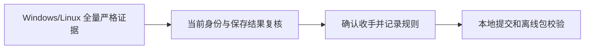

# Windows/Linux C++ 验收收尾

2026-11-04，用户明确要求：Windows/Linux C++ 当前全部登记项与原 DLL 严格一致后即收手，完成本地提交并刷新离线包；将该标准写入 AGENTS.md。**当前收手条件已满足：Windows x64 / Linux x64 各 269/269，合计 538/538，其中 532 项识别输出、6 项预期拒绝契约。** 本轮据此结束逆向开发，不再自行扩展输入、参数、书写者或平台。

## 范围、规则与证据

继续使用固定 reverse-skill `cab634bd855fc287f6e420c1f36fd1a6b9245960` 的 R22/Ghidra 离线案件流程。本轮为验收收尾、规则记录和打包，复用已建立的原 DLL/Ghidra 研究证据，没有新反编译、Hook 或生产算法修改。Scope、Evidence→Finding→Path 与经验记录见 [research/windows-linux-closeout](../../research/windows-linux-closeout/README.md)。

收手规则已写入 [AGENTS.md](../../AGENTS.md)、[人工验收标准](../../docs/acceptance-standard.md)和[机器规则](../../research/acceptance-policy.json)。Windows/Linux 不是仅彼此一致，而是分别对照相同模型、图像和参数的原微软 DLL。保留原比较器、1px / 0.1° / 1e-3 阈值及既有字段契约，未换模型、放宽阈值或忽略失败。

| 证据 | 结果 | 性质 |
|---|---|---|
| [上一轮完整执行](../parameter-expansion-2026-11-04/README.md) | Windows/Linux 各 269/269，532 识别 + 6 拒绝 | 已封存的全量新推理 |
| [本轮复核](native-verification/verification.json) | 538/538，current_scope=true | 读取保存结果，fresh_inference=false |
| [身份核验](evidence/identity.json) | 252 项模型/运行资产摘要通过；验证源码与封存绑定一致 | 实现、模型、运行文件及登记输入未改变 |
| 上一轮完整测试 | 两端 CTest 各 26/26；Python 完整套件 67/67 | 沿用与当前未变更源码相对应的记录 |

本轮不重复完整推理或测试，不把保存结果复核计为新推理。若后续用户要求的改动影响实现、模型、运行资产、输入/参数身份或相关行为，须重新执行受影响平台完整当前范围；旧范围报告不得替代当前范围通过。当前 269 项包括 126 张样本、27 项固定语料、1 张书页、115 组参数。



## 复现与交付身份

```powershell
python scripts/verify-native-results.py --report reports/parameter-expansion-2026-11-04 --output work/fresh-closeout-review
```

`summary.json` 记录本轮 Windows/Linux 验收通过及停止开发决策；最终提交与 bundle、源码 ZIP 的实际摘要以提交后生成的 `artifacts/OFFLINE_PACKAGE.json` 为准。顺序为本地 commit、干净 HEAD 打包、包与当前 HEAD/摘要核验。源码 ZIP 必须包含 AGENTS.md 当前收手规则及完整报告索引。未 push、发布或上传模型。

Linux ARM64、macOS、Android 与新增范围的 Wasm 未验证状态保留，不阻塞本轮完成。历史报告的 `goal_complete=false`、原始完整跨平台目标的 incomplete 和运行时 `engine.parity` 不改写；它们不表示本轮 Windows/Linux 收手验收尚未完成。有限登记范围通过不宣称任意图片或参数均已被证明一致。未来扩大范围由用户另行要求。
