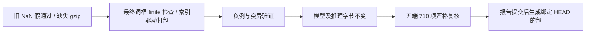

# 词框 NaN 与源码 ZIP 完整性 P2 修复

两个 P2 已修复：最终词框断言显式拒绝非有限坐标，源码包按封存报告索引收齐全部证据。推理源码、运行二进制、模型、114 张图片和严格比较器均保持原样；构建指纹包含新增测试源码。对上一轮五端执行记录按原标准独立全量复核 **710/710**，其中 695 项识别输出、15 项预期拒绝。**本轮是保存结果复核，`fresh_inference=false`，不计为新的 710 次推理。** 原始新推理记录继续保存在[曲线与极长行报告](../curve-boundaries-2026-11-03/README.md)。

## 修复与测试

词框断言使用测试专用 `native/tests/word_box_assertions.hpp`，逐个检查 actual/golden 的四个角点、x/y 坐标均为有限值，再按原内部 0.0001 px 误差比较。原 DLL 退化三角形选择中有意保留的 NaN 控制流没有改变。48 个非有限负例覆盖 actual/golden、四角、双轴及 NaN/正负 Infinity；另有 8 个有限但超限负例和有限值控制项。该检查同时用于原 56 个 DLL 词框预言机。Windows/Linux CTest 均 **10/10**，Wasm 的舍入、FMA、原预言机和新增词框负例均通过。

同一个真实预言机循环注入 NaN：旧提交 `912d0ac` 仍返回 0/PASS，修复后返回 1 并报告 `Nonfinite final word box coordinate`；去掉新有限性 guard 时，新增负例返回 1 并报告 `Nonfinite word box was accepted`。见 [变异验证](evidence/mutation-results.json)。这两个非零退出是预期拒绝，不是测试失败。

源码 ZIP 不再仅依靠扩展名白名单决定封存证据范围：打包前按 `reports/**/FILES.sha256.json` 收齐所有被索引的文件，逐个验证 SHA-256 和长度；生成后从 ZIP 中再次按报告索引验证。此前遗漏的 **10 个 `.log.gz`** 已纳入。旧报告分别使用 `size` 或 `bytes` 长度字段，两种明确格式均被验证，原索引字节不改写；字段冲突、布尔值冒充整数、路径越界及模型/编译文件被索引进入源码包会被拒绝。

源码包新增 **11 个测试**，包含自洽 `SOURCE_BUILD.json` 却缺失/篡改报告证据的反例；缺失或损坏磁盘证据会在写 ZIP 前失败。全部 Python 测试 **58/58**，见 [测试结果](evidence/python-tests.json)。旧源码包由新校验器明确拒绝，见 [旧包证据](evidence/old-package-proof.json)。真实源码 ZIP 另完成报告索引及内容摘要校验：`evidence/source-zip-check.log` 覆盖六份旧封存索引，`evidence/source-zip-sealed-check.log` 进一步覆盖包含本轮报告的七份索引；均为提交前的测试包，不冒充最终包摘要。

## 严格复核与不变项

五端汇总复核 **710/710**，三端单独 compare-only 各 **142/142**。原阈值仍为坐标 1 px、角度 0.1°、置信度 0.001；文字、阅读顺序、词切分和手写类型保持严格一致。三个原 DLL 拒绝用例仍每端单独统计。复核结果在 [strict-verification](strict-verification/verification.json) 和 `single-*` 目录，均明确记录没有新推理。

原始模型 SHA-256 为 `f6cef38b839012cd824abf8b854ee9fa4f87d4c5265440661d66b23f4fab5155`，模型清单仍为 `8e6d5b973aad14590890ce78de39e5414b7297df4350d65e7a2990ab9b9c929a`。155 个模型资源、252 个交付文件、运行二进制指纹、比较器与全部既有封存报告已校验，见 [绑定证据](evidence/unchanged-bindings.json)。旧报告和执行记录没有重写。

源码、测试、构建指纹及本轮报告纳入本地 commit，无 push 或上传。报告提交后运行 `scripts/package-offline.py` 重建 Git 离线包与源码 ZIP，脚本同时验证全部报告索引，最终 HEAD、文件长度和摘要写入本机 `artifacts/OFFLINE_PACKAGE.json` 及两个 `.sha256` 文件。可再生包不嵌套进自身 Git 提交；换机运行资产和所有报告本身均在 Git 中。

## 复现与证据链

按固定 reverse-skill `cab634bd855fc287f6e420c1f36fd1a6b9245960` 的 R22 离线案件流程及 docs-generator 普通模板（flavor=null）执行。授权、范围和过程见 [scope](case/scope.md)、[timeline](case/timeline.md)、[journal](case/field-journal.md)。继续引用上一轮 Ghidra 静态证据，没有修改原 DLL 或新增目标分析。

| Evidence | source_ref | repro_command | content_hash |
| --- | --- | --- | --- |
| E-001 | `evidence/mutation-results.json`、旧/新 NaN 变异源码 | 本目录 `reproduce-mutation.py`；需既有 Linux Ninja 构建及 `evidence/boundary_before_original.cpp` | 本目录 FILES.sha256.json |
| E-002 | Windows/Linux CTest、Wasm 构建日志 | `ctest --test-dir build/source-runtime -C Release --output-on-failure`；Linux 对应目录；`scripts/build-wasm.py` | 同上 |
| E-003 | `evidence/package-source-test.log`、实际 ZIP 检验日志 | `python test/package-source-test.py`；`python scripts/package-source.py --verify artifacts/oneocr-source.zip` | 同上 |
| E-004 | `strict-verification/verification.json`、`evidence/unchanged-bindings.json` | 下方汇总复核命令 | 同上 |

F-001（P2，high，fixed，location=`native/tests/word_box_assertions.hpp`，evidence_ids=E-001/E-002）：修复 NaN 差值比较导致的词框假通过。F-002（P2，high，fixed，location=`scripts/package-source.py`，evidence_ids=E-003）：修复源码 ZIP 省略索引所需的压缩日志。完整内容摘要在 [FILES.sha256.json](FILES.sha256.json)。

P-001，path_type=solve：旧比较器 NaN 假通过 → 最终坐标有限性检查 → 逐坐标负例 → 变异反证 → 原预言机仍通过。P-002，path_type=solve：旧 ZIP 的自洽清单遗漏封存证据 → 按报告索引收齐文件 → 磁盘预检 → ZIP 内再次逐索引核验 → 全量严格复核。



```powershell
python -X utf8 test/package-source-test.py
python -X utf8 scripts/verify-recorded-parity.py --report reports/curve-boundaries-2026-11-03 --output work/p2-record-check-fresh
python -X utf8 scripts/package-source.py --verify artifacts/oneocr-source.zip
```

输出复核目录须为空。变异复现需要先按原生文档准备 Linux Ninja 构建，再用 Linux Python 执行本目录 `reproduce-mutation.py`；脚本创建 work 目录并读取本报告提交的旧版测试源码，只改写该 work 目录中的测试副本，不修改正式源码。

## 未完成和未验证

Windows x64、Linux x64（WSL）与 Wasm 构建/运行证据继续有效；本轮只新增测试和复核记录。Linux ARM64、macOS x64/arm64、Android arm64-v8a 的目标构建与运行仍未验证；Safari、Firefox、移动浏览器及 Node 20 全量集未验证。非默认参数组合、连接/方向歧义及更多独立真实手写覆盖仍未完成。`engine.parity=incomplete`、整体目标未完成和模型权利声明保持原样。
