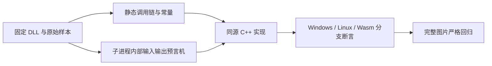

# 曲线备用求解与长行截断证据

按固定 reverse-skill `cab634bd855fc287f6e420c1f36fd1a6b9245960` 的离线样本路由执行。授权范围、路由、版本摘要、静态导出与时间线在本目录；不涉及账号、远程服务或联网推理。动态调用在独立进程中执行，原 DLL 不改写。

当前基准是 Photos 2026.11090.22001.0 / OneOCR 11.0.15，DLL SHA-256 为 `0a5e99041af902d6825f0af04ab25e62d2e2378ace69d10175f0dcc22816aae0`。旧版 9.0.103 DLL 的 SHA-256 为 `0dbbec98e5e33de0be9b12d5f286011a6ea8f18e40baae092542b38ff00e7c7b`，仅作算法交叉核验。模型仍为 `f6cef38b839012cd824abf8b854ee9fa4f87d4c5265440661d66b23f4fab5155`。

`scripts/probe-curve-boundaries.py` 先验证 DLL 摘要，再用固定 RVA 调用。当前版 LU/SVD/宽度/归一化为 `58a380` / `58b580` / `524d80` / `52ab40`，逆映射构造/点映射为 `52fad0` / `52f770`；旧版对应 `e4ea0` / `e48d0` / `d9c40` / `dc510` / `ddd60` / `de340`。

LU 仅在主元恰好为零时退回对正规方程做 SVD，不能用 epsilon 判定或用 SVD 替换所有病态问题。8 组系数含 6 组确实触发备用解和 2 组保留 LU；近奇异的 `[1,1,1,2]` 仍保留 DLL 的 LU 结果。`contract.json` 保存当前 DLL 的完整输入输出。

超长多边形仍保留原始源顶点；截断位置决定输出宽度，但该端点不写入有效目标顶点，后续目标顶点保持零。原 DLL 仍执行所有三角形变换，包括退化三角形。源码复现其像素覆盖顺序、仿射逆映射选择和截断宽度下的翻转。7 组几何覆盖截断前、恰等于、最后段跨越、首段跨越、曲线和一次跳过多个顶点；56 组词框包含两种方向与超出可见区域的帧位置。

`oracle-photos-pixels-*.rgb` 是七幅原始 RGB 像素，`long-detector-input.f32` 为原 DLL 对长行 PNG 产生的 CHW float32 检测器输入。8 组系数、全部归一化像素和检测器输入要求逐元素相等；56 组词框使用 0.0001 像素内部断言，比外部验收标准更严。旧版与当前 DLL 的系数、目标几何、逆矩阵、像素和词框亦全部相同。

长行图片还揭示另一条真实差异：检测器输入缩放后的面积/原面积不超过 0.04 时，DLL 使用 AREA，其他情况使用 LINEAR。静态证据是旧版 `f9680` 的插值映射常量及 `1b2810` 的选择，配合当前版实际检测器输入逐元素验证。该 0.04 是还原的算法常量，验收阈值没有变化。初始 627 项输出差异完整保存在本轮报告的 diagnostics 下，修复后该图严格比较零差异。

有限样本通过不代表所有输入及平台完成。非默认选项组合、独立真实手写及更多文字类别仍需扩大覆盖；macOS、Android、Linux ARM64 和未实测 JS 引擎保持未验证。
