# 传统 OCR 经典案例样本库

30 张独立输入图 · 12 张中文及中英混排 · 9 篇输入来源 · 16 张辅助图。

用于本地研究的精选案例集，覆盖 OpenCV、Tesseract、PaddleOCR、EasyOCR 和 CnOCR；未运行引擎评测，所有样本均未精标。

输入原图位于 `images/`，保留下载或官方压缩包中的原始字节与分辨率。`references/` 中的原文结果、处理对照和拼图仅作参考，不计入输入数量，不充当文字真值。

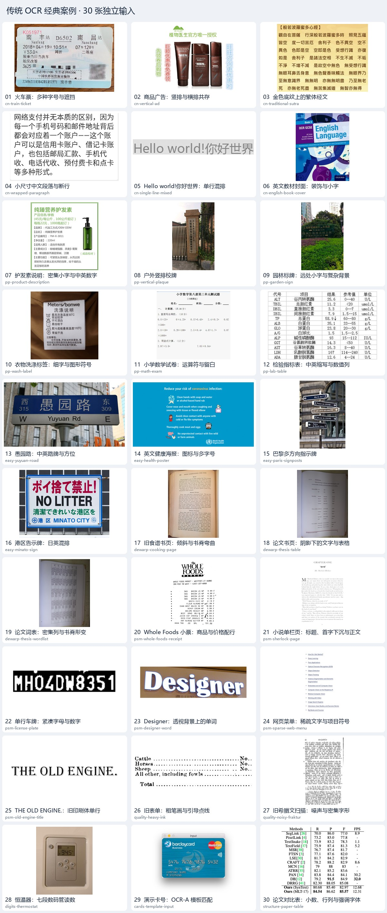

## 使用与重建

在仓库根目录执行（Python 3.7+，依赖 Pillow 9.1+）：

```powershell
python scripts/ocr-classics.py verify
python scripts/ocr-classics.py fetch
python scripts/ocr-classics.py build
python scripts/ocr-classics.py check-links
```

`fetch` 按固定清单获取缺失或损坏的材料，校验通过后才替换文件；重复运行跳过已校验文件。失败返回非零状态，不会以失败材料生成新索引。`verify` 可离线检查输入、辅助图、数量和重复候选。

可用 `--output-dir <目录>` 在新目录重建；`--manifest <文件>` 指定清单。下载可设置 `--timeout`、`--retries`，并用 `--report <文件>` 保存结果。

`manifest.json` 是固定清单：保留 `cases/name/file/tags/source` 字段；`sources` 记录文章和许可，`downloads` 锁定官方压缩包，图片记录校验值、尺寸、直链及解读。GitHub 素材固定到提交。

## 筛选与审阅

每张输入均经助手视觉检查；`visual_review` 明确记录为 `reviewed_by_agent`，不冒充人工精标。文字方向、表格线、商品设计及科学论文插图属于原图内容；原文绘制的 OCR 框、识别答案或处理拼图不作为独立输入。

明显的同图旋转、裁剪和处理版本不重复计数。近似重复采用 256 位 dHash 筛查并结合视觉审阅；该检查不能保证发现所有变形副本。

来源仓库的代码许可与其中第三方图片的权利分别记录；未明确找到素材许可的项目标为未单独声明，不套用本仓库 MIT 许可。

## 分组案例

### 中文排版与混排

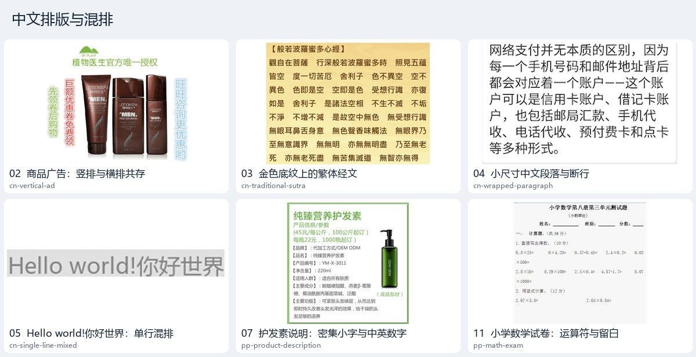

#### 02 · 商品广告：竖排与横排共存

[](images/cn-vertical-ad.png)

[输入原图](images/cn-vertical-ad.png) · 1001 × 807 · [原文：CnOCR：不同场景的使用方法](https://github.com/breezedeus/CnOCR/blob/master/README.md)

- 难点：包装瓶身、横排标题和左右竖排促销文字共存，字色接近背景。
- 原文方案：原文使用支持竖排的专用识别模型处理该例。
- 收录理由：竖排不只出现在古籍，电商广告也是典型场景。
- 原文结果（非真值）：原文给出竖排识别展示；未将其认作阅读顺序真值。
- 标签：中文、竖排、广告、混合方向；标注：未精标。

辅助材料：[ 竖排广告原文识别效果 ](references/cn-vertical-result.jpg)（原文识别结果，非真值，不计入输入）。

#### 03 · 金色底纹上的繁体经文

[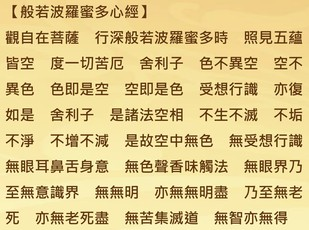](images/cn-traditional-sutra.jpg)

[输入原图](images/cn-traditional-sutra.jpg) · 1270 × 946 · [原文：CnOCR：不同场景的使用方法](https://github.com/breezedeus/CnOCR/blob/master/README.md)

- 难点：繁体字笔画密集，文字落在有纹理的金色底图上。
- 原文方案：原文为繁体中文选择相应语言与识别模型。
- 收录理由：可以观察简繁字符覆盖与背景对细笔画的共同影响。
- 原文结果（非真值）：原文展示繁体识别效果；本库未逐字核对。
- 标签：繁体中文、背景纹理、密集文字；标注：未精标。

辅助材料：[ 繁体经文原文识别效果 ](references/cn-traditional-result.jpg)（原文识别结果，非真值，不计入输入）。

#### 04 · 小尺寸中文段落与断行

[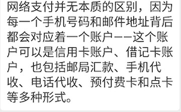](images/cn-wrapped-paragraph.png)

[输入原图](images/cn-wrapped-paragraph.png) · 300 × 187 · [原文：CnOCR：不同场景的使用方法](https://github.com/breezedeus/CnOCR/blob/master/README.md)

- 难点：300 像素宽的文字块存在标点、连字符和跨行断词。
- 原文方案：原文使用 naive_det 按简单排版规则切行，再识别。
- 收录理由：朴素分行在干净截图上仍有价值，适合与复杂检测流程对照。
- 原文结果（非真值）：原文列有逐行识别输出；本库保持未精标。
- 标签：中文、小字、多行、断行；标注：未精标。

#### 05 · Hello world!你好世界：单行混排

[](images/cn-single-line-mixed.jpg)

[输入原图](images/cn-single-line-mixed.jpg) · 256 × 32 · [原文：CnOCR：不同场景的使用方法](https://github.com/breezedeus/CnOCR/blob/master/README.md)

- 难点：图像只有 32 像素高，拉丁字符、中文和标点紧邻。
- 原文方案：原文使用 ocr_for_single_line，省去整图检测。
- 收录理由：同一任务的单行接口与整图接口适用条件清晰，且容易观察中英切换。
- 原文结果（非真值）：原文演示单行识别调用；本库未标注字符真值。
- 标签：中英混排、单行、低高度；标注：未精标。

#### 07 · 护发素说明：密集小字与中英数字

[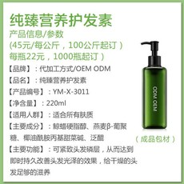](images/pp-product-description.jpg)

[输入原图](images/pp-product-description.jpg) · 500 × 500 · [原文：PaddleOCR 2.x 快速开始](https://github.com/PaddlePaddle/PaddleOCR/blob/main/docs/version2.x/ppocr/quick_start.md)

- 难点：配方、净含量、保质期和型号密集排布，含括号、英文和数字。
- 原文方案：PP-OCR 检测、方向分类和识别组成通用流水线。
- 收录理由：PaddleOCR 快速开始的代表性输入，能集中呈现多种字符。
- 原文结果（非真值）：原文列出文本框、文字与置信度示例；不作为本库真值。
- 标签：中文、商品说明、密集小字、中英数字；标注：未精标。

辅助材料：[ 护发素说明原文框与识别效果 ](references/pp-product-result.jpg)（原文识别结果，非真值，不计入输入）。

#### 11 · 小学数学试卷：运算符与留白

[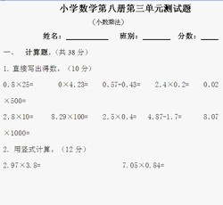](images/pp-math-exam.jpg)

[输入原图](images/pp-math-exam.jpg) · 574 × 528 · [原文：PaddleOCR 2.x 快速开始](https://github.com/PaddlePaddle/PaddleOCR/blob/main/docs/version2.x/ppocr/quick_start.md)

- 难点：标题、题号、算式和大量答题留白造成不均匀布局。
- 原文方案：使用通用 PP-OCR 文本检测与识别；不进行题目求解。
- 收录理由：区分读出题面与理解算式的任务边界，覆盖点号和乘除符号。
- 原文结果（非真值）：该图是官方配套试卷输入；本库未记录答案。
- 标签：中文、试卷、运算符、稀疏排版；标注：未精标。

### 路牌、封面与场景文字

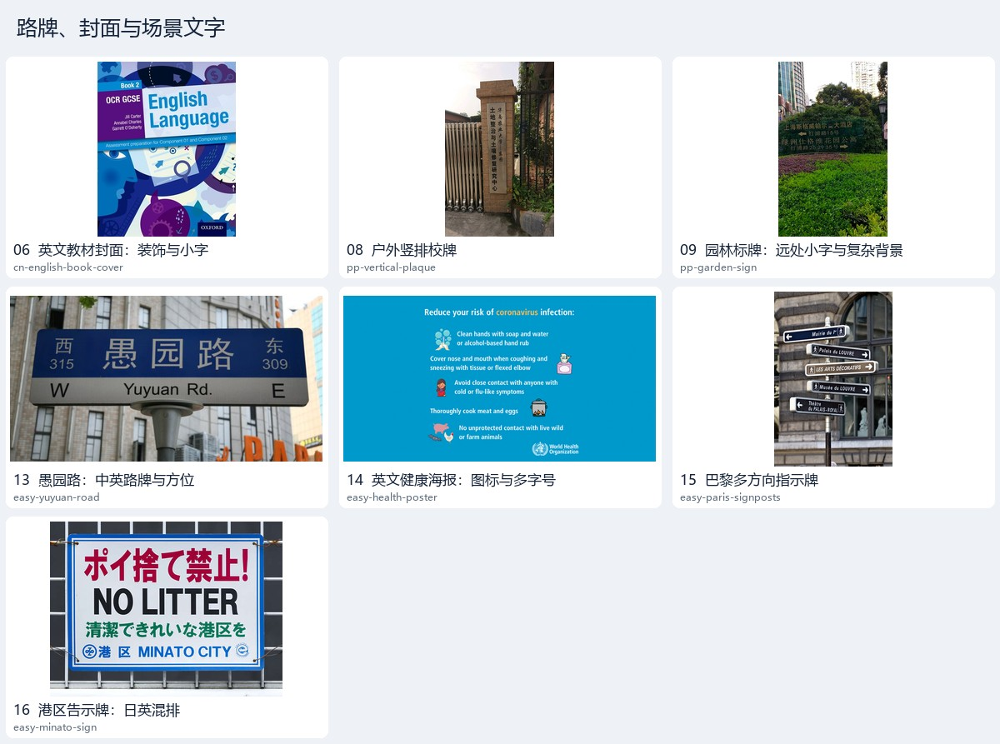

#### 06 · 英文教材封面：装饰与小字

[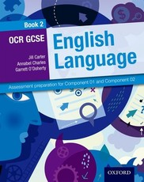](images/cn-english-book-cover.jpeg)

[输入原图](images/cn-english-book-cover.jpeg) · 396 × 500 · [原文：CnOCR：不同场景的使用方法](https://github.com/breezedeus/CnOCR/blob/master/README.md)

- 难点：封面大标题、斜向装饰和低分辨率出版小字混在一起。
- 原文方案：原文改用英文检测与识别模型。
- 收录理由：文字不多却有明显层次，适合观察英文专用模型与通用模型差异。
- 原文结果（非真值）：原文提供英文模型识别示例；未将输出转录为真值。
- 标签：英文、封面、装饰背景、多字号；标注：未精标。

#### 08 · 户外竖排校牌

[](images/pp-vertical-plaque.jpg)

[输入原图](images/pp-vertical-plaque.jpg) · 720 × 1150 · [原文：PaddleOCR 2.x 快速开始](https://github.com/PaddlePaddle/PaddleOCR/blob/main/docs/version2.x/ppocr/quick_start.md)

- 难点：竖排文字位于窄长牌匾，背景含栅栏、树木和阴影。
- 原文方案：使用原文提供的通用检测、方向分类和识别流程。
- 收录理由：与商品竖排广告形成真实户外场景对照。
- 原文结果（非真值）：该图属于原文官方配套测试包；未找到针对该图的逐字结果。
- 标签：中文、竖排、户外、透视；标注：未精标。

#### 09 · 园林标牌：远处小字与复杂背景

[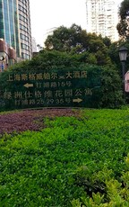](images/pp-garden-sign.jpg)

[输入原图](images/pp-garden-sign.jpg) · 720 × 1150 · [原文：PaddleOCR 2.x 快速开始](https://github.com/PaddlePaddle/PaddleOCR/blob/main/docs/version2.x/ppocr/quick_start.md)

- 难点：深色标牌与树叶、建筑混在一起，字小且对比度低。
- 原文方案：使用通用 PP-OCR 流程定位文本后识别。
- 收录理由：检验自然场景中漏检文字的问题，避免样本全部来自干净纸面。
- 原文结果（非真值）：该图为官方配套样图；本库没有该图的文字真值。
- 标签：中文、户外、低对比度、复杂背景；标注：未精标。

#### 13 · 愚园路：中英路牌与方位

[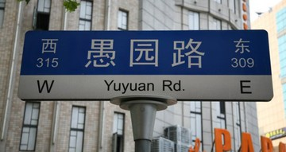](images/easy-yuyuan-road.jpg)

[输入原图](images/easy-yuyuan-road.jpg) · 640 × 339 · [原文：EasyOCR 官方使用与多语言示例](https://github.com/JaidedAI/EasyOCR)

- 难点：愚园路、Yuyuan Rd.、东西方位和门牌号分布在不同位置。
- 原文方案：EasyOCR 使用中英文语言组合，检测后输出框、文本和置信度。
- 收录理由：官方正文长期使用的辨识度很高的中英混排示例。
- 原文结果（非真值）：原文给出该图的框、文字、置信度列表；未作为本库精标。
- 标签：中英混排、路牌、透视、大小字；标注：未精标。

#### 14 · 英文健康海报：图标与多字号

[](images/easy-health-poster.png)

[输入原图](images/easy-health-poster.png) · 905 × 480 · [原文：EasyOCR 官方使用与多语言示例](https://github.com/JaidedAI/EasyOCR)

- 难点：多条小字说明与图标交替排布，色彩背景不均一。
- 原文方案：使用 EasyOCR 英文识别流程；该图来自官方 examples。
- 收录理由：信息图既有主标题又有低像素小字，观察遗漏比只看大标题更有价值。
- 原文结果（非真值）：官方配套输入；本库没有该图逐行核对的结果。
- 标签：英文、海报、多字号、图文混排；标注：未精标。

#### 15 · 巴黎多方向指示牌

[](images/easy-paris-signposts.jpg)

[输入原图](images/easy-paris-signposts.jpg) · 692 × 1024 · [原文：EasyOCR 官方使用与多语言示例](https://github.com/JaidedAI/EasyOCR)

- 难点：多块箭头标牌朝向不同，细字含法语重音字符。
- 原文方案：使用 EasyOCR 相应语言的检测与识别流程。
- 收录理由：在少量多语样本中覆盖标牌方向变化和拉丁扩展字符。
- 原文结果（非真值）：官方 examples 配套图；未转录为字符真值。
- 标签：法文、路牌、多方向、重音字符；标注：未精标。

#### 16 · 港区告示牌：日英混排

[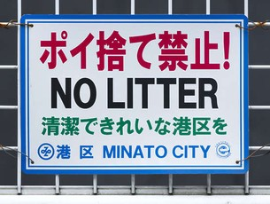](images/easy-minato-sign.jpg)

[输入原图](images/easy-minato-sign.jpg) · 555 × 418 · [原文：EasyOCR 官方使用与多语言示例](https://github.com/JaidedAI/EasyOCR)

- 难点：红、黑、绿、蓝四色文字混排，日文与英文层次不同。
- 原文方案：使用 EasyOCR 日文与英文语言组合。
- 收录理由：同一招牌包含假名、汉字和英文，补充非中文汉字场景。
- 原文结果（非真值）：官方 examples 配套图；日文中的汉字不计为中文样本。
- 标签：日英混排、告示牌、多字号；标注：未精标。

### 票据与商品标签


#### 01 · 火车票：多种字号与遮挡

[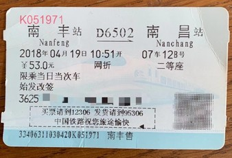](images/cn-train-ticket.jpeg)

[输入原图](images/cn-train-ticket.jpeg) · 1368 × 930 · [原文：CnOCR：不同场景的使用方法](https://github.com/breezedeus/CnOCR/blob/master/README.md)

- 难点：站名、车次、日期、价格分散排布，票面含纹理，部分信息被遮挡。
- 原文方案：CnOCR 先检测文字区域，再逐区域识别。
- 收录理由：真实票据同时考验定位与字符识别；遮挡内容不能靠上下文补写。
- 原文结果（非真值）：原文给出车票识别效果图；本库未转录为真值。
- 标签：中文、票据、多字号、遮挡；标注：未精标。

辅助材料：[ 车票原文识别效果 ](references/cn-ticket-result.jpg)（原文识别结果，非真值，不计入输入）。

#### 10 · 衣物洗涤标签：细字与图形符号

[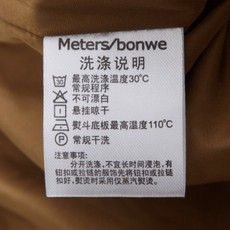](images/pp-wash-label.jpg)

[输入原图](images/pp-wash-label.jpg) · 350 × 350 · [原文：PaddleOCR 2.x 快速开始](https://github.com/PaddlePaddle/PaddleOCR/blob/main/docs/version2.x/ppocr/quick_start.md)

- 难点：品牌英文、中文说明、温度数字与洗涤图标挤在小标签上。
- 原文方案：按原文通用流程识别文字，图标不等同于可识别文字。
- 收录理由：展示小字号和符号干扰，适合观察过检与漏检。
- 原文结果（非真值）：官方配套测试图；没有转录图标或中文说明为真值。
- 标签：中文、标签、小字、图文混排；标注：未精标。

### 弯曲书页与阴影

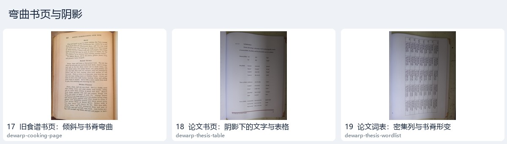

#### 17 · 旧食谱书页：倾斜与书脊弯曲

[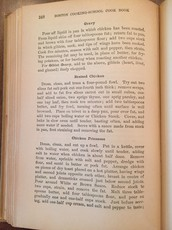](images/dewarp-cooking-page.jpg)

[输入原图](images/dewarp-cooking-page.jpg) · 3264 × 2448 · [原文：Page dewarping](https://mzucker.github.io/2016/08/15/page-dewarping.html)

- 难点：整页方向倾斜，靠近书脊处有弯曲、阴影及字号变化。
- 原文方案：原文提取文字行轮廓，拟合三次曲面模型后重映射展平。
- 收录理由：经典几何方法展示为什么仅做二维旋转无法解决书页弯曲。
- 原文结果（非真值）：原文展示展平前后对照；这是几何预处理结果，不是 OCR 真值。
- 标签：英文、书页、弯曲、旋转；标注：未精标。

辅助材料：[ 食谱页展平前后 ](references/dewarp-cooking-comparison.png)（原文预处理对照拼图，不计入输入）。

#### 18 · 论文书页：阴影下的文字与表格

[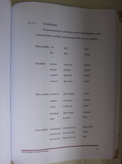](images/dewarp-thesis-table.jpg)

[输入原图](images/dewarp-thesis-table.jpg) · 3456 × 4608 · [原文：Page dewarping](https://mzucker.github.io/2016/08/15/page-dewarping.html)

- 难点：纸页一侧偏暗，稀疏文字与表格线同时存在。
- 原文方案：从符合文字行特征的轮廓中采样，优化页姿态和曲面参数。
- 收录理由：把表格边线、文字行和弯曲同时纳入考察。
- 原文结果（非真值）：原文有关键点拟合及展平对照；本库只保存原文参考图。
- 标签：英文、书页、阴影、表格；标注：未精标。

辅助材料：[ 论文表格页展平前后 ](references/dewarp-thesis-a-comparison.png)（原文预处理对照拼图，不计入输入）。

#### 19 · 论文词表：密集列与书脊形变

[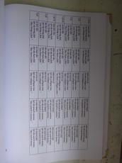](images/dewarp-thesis-wordlist.jpg)

[输入原图](images/dewarp-thesis-wordlist.jpg) · 3456 × 4608 · [原文：Page dewarping](https://mzucker.github.io/2016/08/15/page-dewarping.html)

- 难点：长词表紧密排列成列，弯曲造成不同行的形变不同。
- 原文方案：原文沿多条文本跨度拟合页曲面并执行去畸变。
- 收录理由：与稀疏表格页构成不同版面，避免把同页不同旋转重复计数。
- 原文结果（非真值）：原文展示该页的展平前后图，未提供本库所需的精标文字。
- 标签：英文、多列、书页、弯曲；标注：未精标。

辅助材料：[ 论文词表页展平前后 ](references/dewarp-thesis-b-comparison.png)（原文预处理对照拼图，不计入输入）。

### Tesseract 版面分割

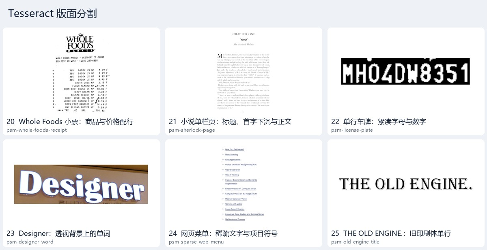

#### 20 · Whole Foods 小票：商品与价格配行

[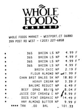](images/psm-whole-foods-receipt.png)

[输入原图](images/psm-whole-foods-receipt.png) · 1000 × 1334 · [原文：Tesseract Page Segmentation Modes (PSMs) Explained](https://pyimagesearch.com/2021/11/15/tesseract-page-segmentation-modes-psms-explained-how-to-improve-your-ocr-accuracy/)

- 难点：商品名称与金额位于不同列，不能只按独立文字块阅读。
- 原文方案：原文以 --psm 4 对按列排布的小票进行逐行识别。
- 收录理由：PSM 选择改变的是版面假设，商品和价格关系是经典观察点。
- 原文结果（非真值）：原文对比不同 PSM 的终端输出；不将其视作本库真值。
- 标签：英文、小票、列关系、PSM4；标注：未精标。

#### 21 · 小说单栏页：标题、首字下沉与正文

[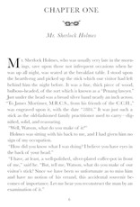](images/psm-sherlock-page.png)

[输入原图](images/psm-sherlock-page.png) · 1000 × 1471 · [原文：Tesseract Page Segmentation Modes (PSMs) Explained](https://pyimagesearch.com/2021/11/15/tesseract-page-segmentation-modes-psms-explained-how-to-improve-your-ocr-accuracy/)

- 难点：章节标题与正文间留白较大，首字采用下沉排版。
- 原文方案：原文用 --psm 6 设定为单个统一文本块。
- 收录理由：版面先验合适时，通用引擎可以明显改变识别结果。
- 原文结果（非真值）：原文给出该模式下的段落输出；本库未逐字符核对。
- 标签：英文、单栏、首字下沉、PSM6；标注：未精标。

#### 22 · 单行车牌：紧凑字母与数字

[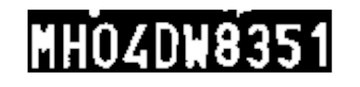](images/psm-license-plate.png)

[输入原图](images/psm-license-plate.png) · 1000 × 243 · [原文：Tesseract Page Segmentation Modes (PSMs) Explained](https://pyimagesearch.com/2021/11/15/tesseract-page-segmentation-modes-psms-explained-how-to-improve-your-ocr-accuracy/)

- 难点：字符窄、相互贴近，图像为高对比度单行裁切。
- 原文方案：原文使用 --psm 7，将输入视为单行文本。
- 收录理由：为单行假设提供直接案例；车牌字符不是普通词典单词。
- 原文结果（非真值）：原文展示车牌字符串结果；未升级为本库真值。
- 标签：英文、数字、车牌、PSM7；标注：未精标。

#### 23 · Designer：透视背景上的单词

[](images/psm-designer-word.png)

[输入原图](images/psm-designer-word.png) · 1000 × 379 · [原文：Tesseract Page Segmentation Modes (PSMs) Explained](https://pyimagesearch.com/2021/11/15/tesseract-page-segmentation-modes-psms-explained-how-to-improve-your-ocr-accuracy/)

- 难点：单词位于倾斜的彩色牌面，字符有衬线与阴影。
- 原文方案：原文使用 --psm 8，把输入视为一个单词。
- 收录理由：突出单词级输入与整页分割假设之间的差别。
- 原文结果（非真值）：原文给出单词识别输出；没有人工精标。
- 标签：英文、单词、透视、PSM8；标注：未精标。

#### 24 · 网页菜单：稀疏文字与项目符号

[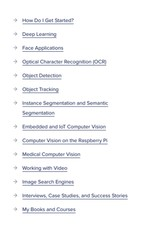](images/psm-sparse-web-menu.png)

[输入原图](images/psm-sparse-web-menu.png) · 1000 × 1624 · [原文：Tesseract Page Segmentation Modes (PSMs) Explained](https://pyimagesearch.com/2021/11/15/tesseract-page-segmentation-modes-psms-explained-how-to-improve-your-ocr-accuracy/)

- 难点：链接逐条分散在大块留白中，带下划线和项目符号。
- 原文方案：原文用 --psm 11 尽量寻找稀疏文字。
- 收录理由：能观察“找全所有文字”与“恢复正确阅读顺序”的区别。
- 原文结果（非真值）：原文比较稀疏文字模式的输出；本库未定义阅读顺序真值。
- 标签：英文、截图、稀疏文字、PSM11；标注：未精标。

#### 25 · THE OLD ENGINE.：旧印刷体单行

[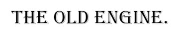](images/psm-old-engine-title.png)

[输入原图](images/psm-old-engine-title.png) · 1000 × 200 · [原文：Tesseract Page Segmentation Modes (PSMs) Explained](https://pyimagesearch.com/2021/11/15/tesseract-page-segmentation-modes-psms-explained-how-to-improve-your-ocr-accuracy/)

- 难点：衬线字形、较大的字符间距和尾部标点影响普通分割。
- 原文方案：原文使用 --psm 13 的 raw line 模式处理整行。
- 收录理由：保留一个绕过部分常规分割处理的经典模式案例。
- 原文结果（非真值）：原文给出该行结果；不是本库字符真值。
- 标签：英文、旧印刷、单行、PSM13；标注：未精标。

### 旧扫描与图像质量

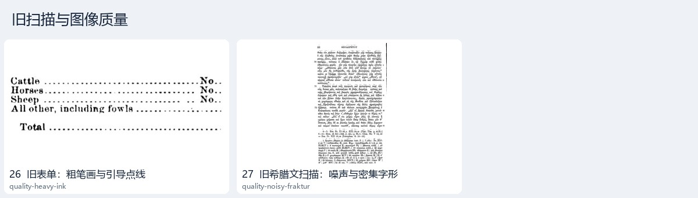

#### 26 · 旧表单：粗笔画与引导点线

[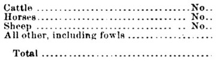](images/quality-heavy-ink.png)

[输入原图](images/quality-heavy-ink.png) · 403 × 114 · [原文：Improving the quality of the output](https://tesseract-ocr.github.io/tessdoc/ImproveQuality.html)

- 难点：粗衬线笔画和连续引导点线挤在小尺寸扫描区域中。
- 原文方案：原文以形态学腐蚀展示粗笔画的处理方式。
- 收录理由：处理会改变笔画细节；对照图用于观察变化，不预设一定改善。
- 原文结果（非真值）：原文提供腐蚀处理图，属于预处理对照，不是识别答案。
- 标签：英文、旧扫描、粗笔画、点线；标注：未精标。

辅助材料：[ 腐蚀处理后的旧表单 ](references/quality-erosion-comparison.png)（原文预处理结果，不计入输入）。

#### 27 · 旧希腊文扫描：噪声与密集字形

[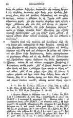](images/quality-noisy-fraktur.png)

[输入原图](images/quality-noisy-fraktur.png) · 370 × 600 · [原文：Improving the quality of the output](https://tesseract-ocr.github.io/tessdoc/ImproveQuality.html)

- 难点：整页字形细密、存在斑点与扫描噪声，字体与现代字形差异大。
- 原文方案：原文讨论去噪及二值化无法自动解决所有噪声问题。
- 收录理由：把字体覆盖与图像噪声同时保留下来，避免将困难全部归因于模型。
- 原文结果（非真值）：原文此处用于说明噪声，没有提供该图的逐字 OCR 真值。
- 标签：希腊文、旧扫描、噪声、密集文字；标注：未精标。

### 专用数字识别

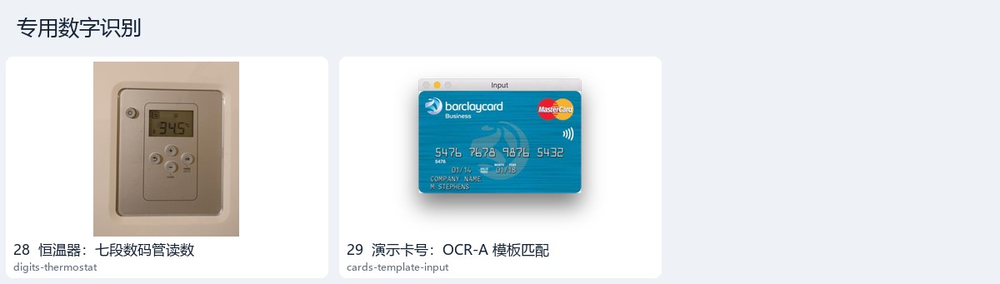

#### 28 · 恒温器：七段数码管读数

[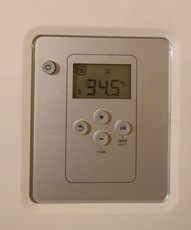](images/digits-thermostat.jpg)

[输入原图](images/digits-thermostat.jpg) · 734 × 882 · [原文：Recognizing digits with OpenCV and Python](https://pyimagesearch.com/2017/02/13/recognizing-digits-with-opencv-and-python/)

- 难点：液晶数字由分离笔段组成，字符形状与普通印刷体不同。
- 原文方案：原文依次定位液晶屏、透视矫正、阈值化，再判断七段亮灭编码。
- 收录理由：不需要通用文字模型的经典专用识别方案。
- 原文结果（非真值）：原文最终效果图显示读数；本库没有将显示结果转为真值。
- 标签：数字、数码管、透视、七段编码；标注：未精标。

辅助材料：[ 液晶屏透视矫正结果 ](references/digits-warped.png)（原文预处理结果，不计入输入）。

辅助材料：[ 数码管最终识别效果 ](references/digits-result.jpg)（原文识别结果，非真值，不计入输入）。

#### 29 · 演示卡号：OCR-A 模板匹配

[](images/cards-template-input.jpg)

[输入原图](images/cards-template-input.jpg) · 600 × 470 · [原文：Credit card OCR with OpenCV and Python](https://pyimagesearch.com/2017/07/17/credit-card-ocr-with-opencv-and-python/)

- 难点：卡面数字带压印和背景色，需先定位成组数字。
- 原文方案：原文使用形态学、梯度、轮廓分组与 OCR-A 数字模板匹配。
- 收录理由：演示受约束字体下的传统识别方法，输入窗口边框完整保留。
- 原文结果（非真值）：原文的识别效果图另存；演示数字不作为本库精标。
- 标签：数字、卡片、模板匹配、输入示意；标注：未精标。

辅助材料：[ 卡号模板匹配原文效果 ](references/cards-result.jpg)（原文识别结果，非真值，不计入输入）。

### 表格与列关系

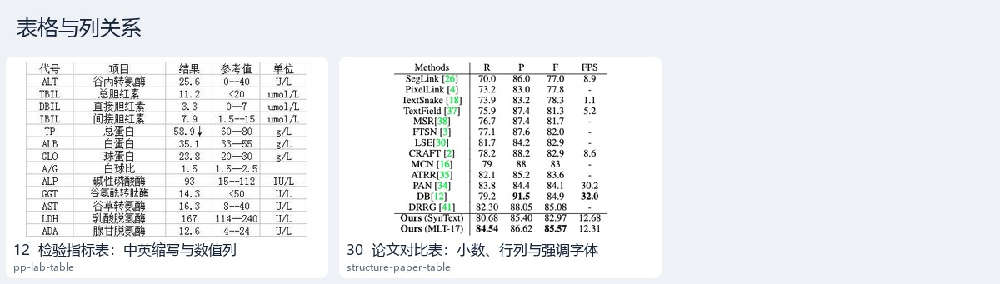

#### 12 · 检验指标表：中英缩写与数值列

[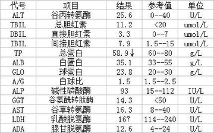](images/pp-lab-table.jpg)

[输入原图](images/pp-lab-table.jpg) · 430 × 267 · [原文：PaddleOCR 2.x 快速开始](https://github.com/PaddlePaddle/PaddleOCR/blob/main/docs/version2.x/ppocr/quick_start.md)

- 难点：缩写、中文项目名、结果、参考范围和单位依赖列关系。
- 原文方案：通用 OCR 先获得文字与坐标，表格结构需要另行处理。
- 收录理由：即使逐字正确，列错位也可能让结果失去意义。
- 原文结果（非真值）：来自官方配套测试包；不推断检测含义或生成结构化真值。
- 标签：中文、表格、中英混排、小数、单位；标注：未精标。

#### 30 · 论文对比表：小数、行列与强调字体

[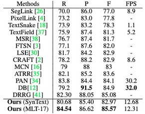](images/structure-paper-table.jpg)

[输入原图](images/structure-paper-table.jpg) · 371 × 293 · [原文：PP-Structure 快速使用](https://github.com/PaddlePaddle/PaddleOCR/blob/main/docs/version2.x/ppstructure/quick_start.md)

- 难点：方法名称、引用编号、小数及横线共同构成表格，部分值以粗体强调。
- 原文方案：PP-Structure 使用表格结构模型与 OCR 结果组合恢复单元格。
- 收录理由：与中文检验表对照，突出文字正确但结构仍可能错误的情况。
- 原文结果（非真值）：原文演示表格识别调用；本库不将结构输出标作真值。
- 标签：英文、表格、小数、粗体；标注：未精标。

## 来源与许可

| 来源 | 作者 | 输入数 | 已查到的许可信息 |
|---|---|---:|---|
| [CnOCR：不同场景的使用方法](https://github.com/breezedeus/CnOCR/blob/master/README.md) | Breezedeus / CnOCR contributors | 6 | Apache-2.0（仓库代码）；未发现针对所选图片的单独许可声明，保留原来源权利信息。 |
| [PaddleOCR 2.x 快速开始](https://github.com/PaddlePaddle/PaddleOCR/blob/main/docs/version2.x/ppocr/quick_start.md) | PaddleOCR contributors | 6 | Apache-2.0（仓库代码）；未发现针对所选图片的单独许可声明，保留原来源权利信息。 |
| [EasyOCR 官方使用与多语言示例](https://github.com/JaidedAI/EasyOCR) | JaidedAI / EasyOCR contributors | 4 | Apache-2.0（仓库代码）；未发现针对所选图片的单独许可声明，保留原来源权利信息。 |
| [Page dewarping](https://mzucker.github.io/2016/08/15/page-dewarping.html) | Matt Zucker | 3 | MIT（仓库代码）；未发现针对所选图片的单独许可声明，保留原来源权利信息。 |
| [Tesseract Page Segmentation Modes (PSMs) Explained](https://pyimagesearch.com/2021/11/15/tesseract-page-segmentation-modes-psms-explained-how-to-improve-your-ocr-accuracy/) | Adrian Rosebrock | 6 | 未发现素材复用许可；原网站版权信息；未发现针对所选图片的单独许可声明，保留原来源权利信息。 |
| [Improving the quality of the output](https://tesseract-ocr.github.io/tessdoc/ImproveQuality.html) | Tesseract documentation contributors | 2 | 未在所选文档中发现单独的图片许可；未发现针对所选图片的单独许可声明，保留原来源权利信息。 |
| [Recognizing digits with OpenCV and Python](https://pyimagesearch.com/2017/02/13/recognizing-digits-with-opencv-and-python/) | Adrian Rosebrock | 1 | 未发现素材复用许可；原网站版权信息；未发现针对所选图片的单独许可声明，保留原来源权利信息。 |
| [Credit card OCR with OpenCV and Python](https://pyimagesearch.com/2017/07/17/credit-card-ocr-with-opencv-and-python/) | Adrian Rosebrock | 1 | 未发现素材复用许可；原网站版权信息；未发现针对所选图片的单独许可声明，保留原来源权利信息。 |
| [PP-Structure 快速使用](https://github.com/PaddlePaddle/PaddleOCR/blob/main/docs/version2.x/ppstructure/quick_start.md) | PaddleOCR contributors | 1 | Apache-2.0（仓库代码）；未发现针对所选图片的单独许可声明，保留原来源权利信息。 |
| [Automatically OCR’ing Receipts and Scans](https://pyimagesearch.com/2021/10/27/automatically-ocring-receipts-and-scans/) | Adrian Rosebrock | 0 | 未发现素材复用许可；原网站版权信息；未发现针对所选图片的单独许可声明，保留原来源权利信息。 |

GitHub 原文快照、素材地址、素材获取日期及许可证据地址详见 `manifest.json`。

## 补充辅助材料

- [不均匀背景与二值化对照](references/quality-binarisation-comparison.png)：原文预处理对照拼图；[原文](https://tesseract-ocr.github.io/tessdoc/ImproveQuality.html)。
- [倾斜书页与行方向对照](references/quality-skew-comparison.png)：原文预处理对照拼图；[原文](https://tesseract-ocr.github.io/tessdoc/ImproveQuality.html)。
- [扫描黑边处理对照](references/quality-border-comparison.png)：原文预处理对照拼图；[原文](https://tesseract-ocr.github.io/tessdoc/ImproveQuality.html)。
- [小票输入与边缘检测拼图](references/receipt-edges.png)：原文输入与预处理拼图；[原文](https://pyimagesearch.com/2021/10/27/automatically-ocring-receipts-and-scans/)。
- [小票轮廓与透视矫正拼图](references/receipt-perspective.png)：原文预处理对照拼图；[原文](https://pyimagesearch.com/2021/10/27/automatically-ocring-receipts-and-scans/)。

小票扫描教程公开配图为处理拼图，作为补充辅助材料保存；独立小票输入取自 PSM 教程。二者不作为独立重复样本计数。
